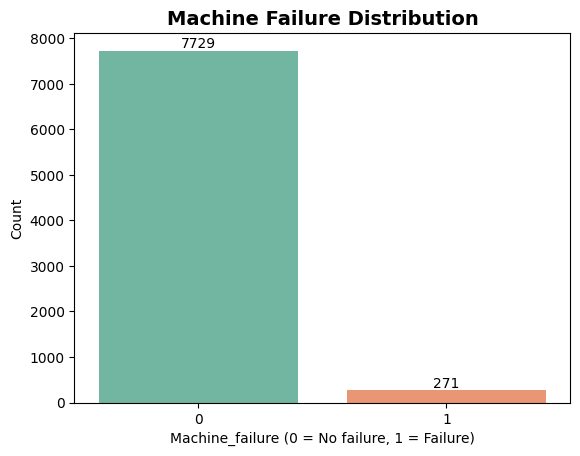
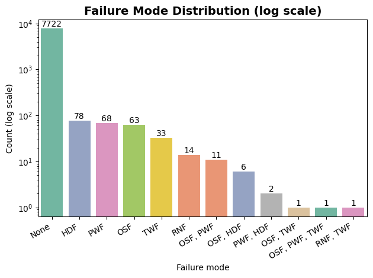
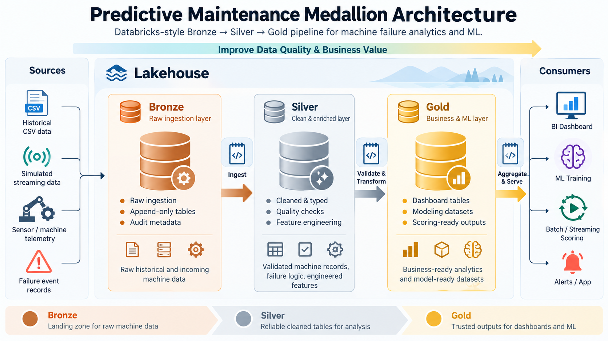
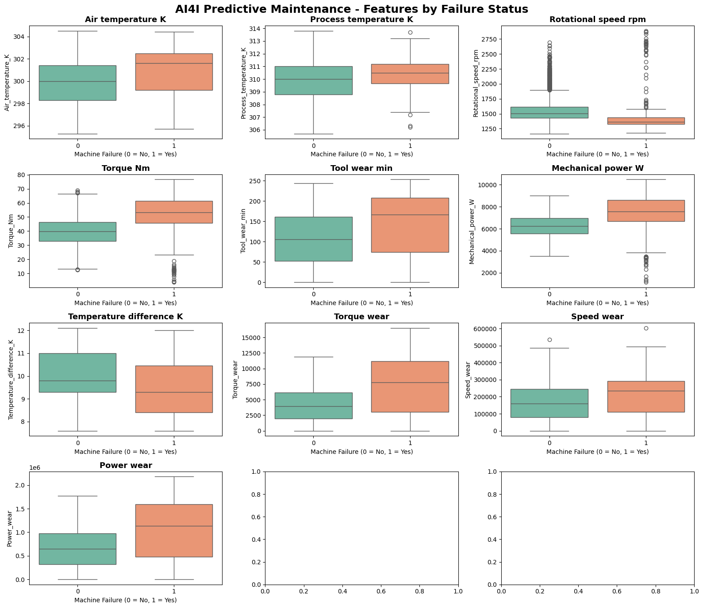
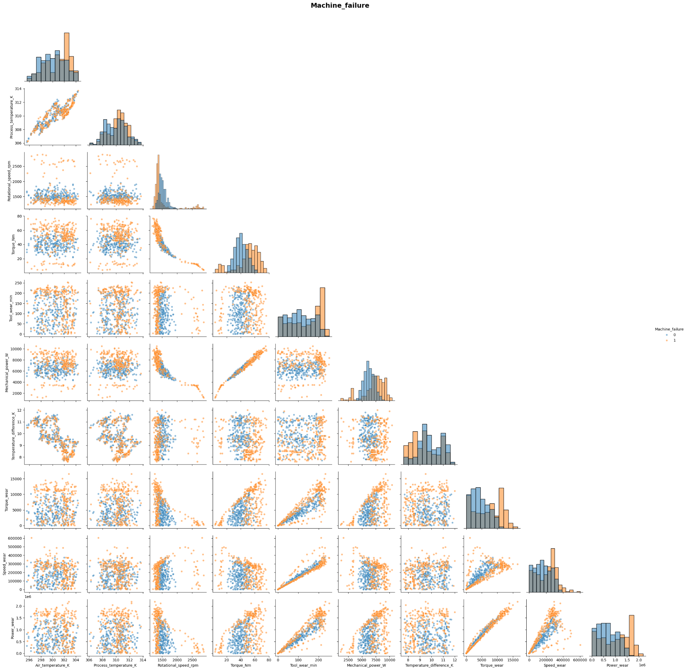

# Dataset Exploration

## What the  Dataset Contains

The Predictive Maintenance Dataset contains 10,000 records representing machine operating conditions and associated failure information. It is a synthetic dataset designed for predictive maintenance research and experimentation.

The main operating variables include:
| Feature | Description |
| :--- | :--- |
| **Type** | Machine product type |
| **Air temperature [K]** | Ambient air temperature |
| **Process temperature [K]** | Operating process temperature |
| **Rotational speed [rpm]** | Machine rotational speed |
| **Torque [Nm]** | Operating torque |
| **Tool wear [min]** | Accumulated tool wear |

The target variable is **Machine_failure**.

The dataset also contains failure-mode indicators, including:

**TWF** — Tool Wear Failure

**HDF** — Heat Dissipation Failure

**PWF** — Power Failure

**OSF** — Overstrain Failure

**RNF** — Random Failure

There are also other target variables that are going to answer what is the failure mode when the machine fails?

## Data Partitioning Strategy

To simulate a practical deployment scenario, the dataset is divided into an initial historical portion and a separate portion reserved for simulated incoming data.
| Dataset portion | Records | Purpose |
| :--- | :--- | :--- |
| **Historical dataset** | 8,000 | Initial data engineering and model development |
| **Training set** | 6,400 | Model fitting |
| **Validation set** | 1,600 | Model comparison and threshold selection |
| **Held-out dataset** | 2,000 | Future streaming simulation and final evaluation |
| **Total** | 10,000 | |

The 8,000-record historical portion is divided into training and validation sets using stratified sampling to preserve the failure-class distribution.

The held-out 2,000 records are reserved for subsequent evaluation after the model and decision threshold have been selected. Since, the dataset does not provide a genuine production timestamp, the partition should not be interpreted as a true chronological evaluation of future machine behavior.

## Class Imbalance

A key characteristic of the dataset is the strong imbalance between healthy and failed machines. Approximately 3.4% of the records represent machine failures, while the remaining records represent non-failure cases.

This imbalance has important implications for model development. A classifier can achieve high overall accuracy simply by predicting that most machines will not fail, while still missing a substantial proportion of actual failures.

The modeling workflow therefore evaluates the ability to identify minority-class failures rather than relying on accuracy alone.

<i>Fig 1: 271 failed and 7729 are healthy</i>

<i>Fig 2: Failure mode distribution. Log scale for ease of comparison</i>

## A Quirk: `Machine_failure` vs. Failure Mode Flags

The `Machine_failure` target does not perfectly align with the failure-mode flags (`TWF`, `HDF`, `PWF`, `OSF`, and `RNF`). This discrepancy was verified in the 8,000-row historical dataset, `gold_data.gold_data_historical_stratified`.

### What the data shows

| Classification | Count |
|---|---:|
| `Machine_failure = 0` | 7,729 |
| `Machine_failure = 1` | 271 |
| `failure_mode = "None"` | 7,722 |
| Records with an attributed failure mode | 278 |

The difference arises from two cases:

1. **14 RNF-only records are not labeled as machine failures.** The Random Failure (`RNF`) flag is set, but `Machine_failure = 0`.
2. **7 records are labeled as machine failures without an attributed failure mode.** `Machine_failure = 1`, but all five failure-mode flags are zero.

Consequently, `Machine_failure = 0` contains 14 RNF-only records that are excluded from the `"None"` category, while `"None"` contains 7 records labeled as failures.

The net difference is seven records: \(14 - 7 = 7\).

### Multiple failure modes

Some records have more than one failure-mode flag set. These are assigned combined labels, such as `"OSF, PWF"` or `"OSF, PWF, TWF"`, rather than being assigned to a single mode.

The failure-mode distribution chart therefore counts mutually exclusive mode combinations, not independent occurrences of each flag.

## Data Engineering: Medallion Architecture

The project follows the Bronze, Silver, and Gold Medallion Architecture in Databricks. The objective is to separate raw data ingestion from data preparation and downstream analytical use.

<i>Fig 3: Databricks Medallion Architecture</i>

###Bronze Layer — Raw Data Ingestion

The Bronze layer is the landing area for the source machine data.

Its responsibilities include:

* Ingesting the source CSV data into Databricks.

* Preserving the original fields for traceability.

* Supporting repeatable ingestion of historical data and simulated incoming records.

* Providing a foundation for subsequent data quality and transformation steps.

Pipeline metadata, such as ingestion timestamps and source-file information, can be incorporated to improve traceability.

###Silver Layer — Data Cleaning and Validation

The Silver layer prepares the ingested data for reliable analysis and modeling.

The workflow includes schema and data-type checks, data quality validation, and consistent preparation of the machine operating variables. The same transformation logic should be applied to historical and subsequently ingested records to prevent discrepancies between training and inference data.

###Gold Layer — Analytics and Modeling

The Gold layer contains curated datasets for downstream consumption.

These datasets support:

* Machine failure rate analysis.

* Failure-mode analysis.

* Comparisons across machine types.

* Dashboard visualizations.

* Preparation of modeling datasets.

The Gold layer provides a common analytical foundation for both the dashboard and machine learning workflow.

### Simulated Streaming Workflow

After the historical pipeline and model have been established, the remaining 2,000 records will be introduced in batches to simulate incoming machine data.

The intended workflow is:

1. Ingest incoming records into Bronze.

2. Apply the same Silver transformations and data quality checks.

3. Update the appropriate Gold datasets.

4. Score eligible records using the trained model and its saved decision threshold.

5. Compare predictions with known outcomes and analyze model performance.

This exercise demonstrates the distinction between training a model on historical data and applying an existing model to newly arriving records.

## Exploratory Data Analysis

Exploratory data analysis was performed to understand the distribution of operating variables, investigate relationships between machine conditions and failure outcomes, and identify patterns that could inform feature engineering.

The analysis includes:

* Failure and non-failure class distributions.

* Pairplots of operating variables, grouped by failure status or failure mode.

* Correlation heatmaps.

* Boxplots comparing operating conditions between failed and healthy machines.

* Failure rates across binned operating variables.

* Comparisons of failure behavior across machine types and failure modes.

A dashboard was also created that uses analytical tables to examine machine-level and failure-mode summaries.

## Feature Engineering

The project initially uses the six operating predictors described above. Additional engineered predictors have subsequently been evaluated against the original feature set.

Five additional features were created to capture relationships between machine operating conditions and accumulated tool wear.

| Feature | Calculation | Purpose |
| :--- | :--- | :--- |
| **Mechanical_power_W** | $$ (\frac{2\pi}{60}\times \text{Rotational speed}\times \text{Torque}) $$| Estimates mechanical power, combining rotational speed and torque into a measure of operating load. |
| **Temperature_difference_K** | Process_temperature_K - Air_temperature_K | Measures the temperature difference between the process and ambient air, potentially indicating heat-dissipation stress. |
| **Torque_wear** | Torque_Nm × Tool_wear_min | Captures the interaction between mechanical torque and accumulated tool wear. |
| **Speed_wear** | Rotational_speed_rpm × Tool_wear_min | Captures the interaction between rotational speed and accumulated tool wear. |
| **Power_wear** | Mechanical_power_W × Tool_wear_min | Combines mechanical power and accumulated wear to represent operating load under increasing wear conditions. |

These features were introduced to help the models capture relationships that may not be adequately represented by individual operating variables alone.

The purpose of this comparison is to determine whether derived features improve predictive performance rather than assuming that a larger feature set will automatically produce a better model.

Feature engineering is evaluated using the same classification metrics and validation data as the original predictors.

Further feature selection and importance analysis will help determine which additional predictors contribute meaningful information and whether the final model can be simplified without sacrificing performance.

## Key Findings

The most important finding is that machine failure is a minority-class outcome. This requires explicit attention to recall, precision, and alert volume during model evaluation.

The exploratory analysis also provides a foundation for investigating how temperature, rotational speed, torque, tool wear, and machine type relate to failure risk.

<i>Fig 4: Box plot showing what affects machine failure</i>

The boxplots show clear differences between failed and non-failed machines. Failed machines generally exhibit higher air and process temperatures, higher torque, greater tool wear, and higher mechanical power. They also tend to have lower rotational speeds and smaller temperature differences between process and ambient air.

The engineered interaction features (Torque_wear, Speed_wear, and Power_wear) also show higher median values among failed machines, suggesting they may help capture combinations of operating load and accumulated wear associated with failure. However, the distributions overlap considerably, indicating that no single feature is sufficient to reliably distinguish failed machines from healthy ones. These findings support using multiple features together in the classification models.

<i>Fig 5: PairPlot</i>

The pairplot shows the distributions and pairwise relationships of the original and engineered features, colored by Machine_failure. Because machine failures are much less frequent than non-failures, the failed machines are harder to see clearly in the scatterplots and histograms. Even so, there are signs that failed machines tend to appear more often at higher torque, higher tool wear, and higher engineered interaction features such as Torque_wear, Speed_wear, and Power_wear. To see the failed machines more clearly, it is better to make the plot on a balanced sample (all failures plus an equal number of non-failures), or to create targeted plots such as boxplots, violin plots, or scatterplots using only the failure class versus a sample of healthy machines. That will make the failure patterns much easier to interpret visually.

The plot also shows some strong built-in relationships among the engineered features. For example, Mechanical_power_W is strongly related to Torque_Nm, and the wear interaction features increase naturally with both load and tool wear. However, there is still substantial overlap between failure and non-failure points, which suggests that failures are not separated by one single variable alone, but rather by combinations of conditions.

These relationships are useful for selecting predictors and evaluating derived features, but visual associations alone do not establish that a variable causes a machine failure.
