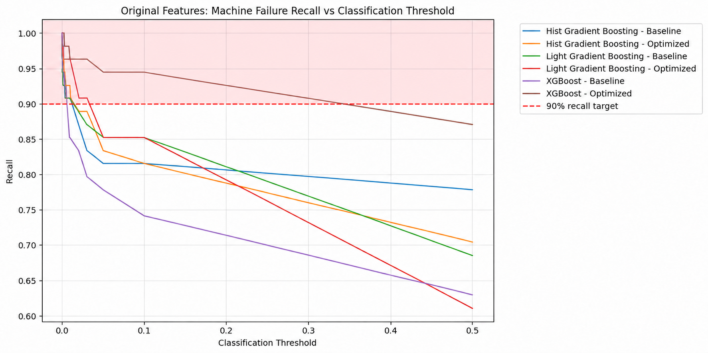
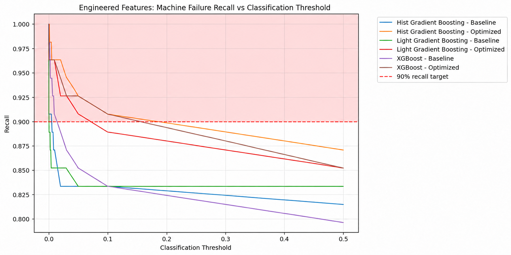

# Machine Learning and Model Evaluation

## Modeling Approach
The project has progressed from exploratory analysis to supervised model training and validation.

The model families being evaluated include:

* Logistic Regression.

* Decision Tree.

* Random Forest.

* HistGradientBoosting.

* XGBoost.

* LightGBM.

The experiments include baseline models and selected hyperparameter-optimized variants.

The workflow for the modeling is described below.

Since we wanted to check if the engineered features made a difference, the engineered features was compared to the original features

<i>Fig 1: Overall workflow </i>

## Preprocessing Pipeline and Data Transformation

A reusable preprocessing pipeline was implemented using scikit-learn's `ColumnTransformer` and `Pipeline`. Numerical features were imputed using the median and standardized using `StandardScaler`, while the categorical `Type` feature was imputed and transformed using one-hot encoding.

The same preprocessing framework was used across all six classification models to maintain consistency during model comparison. Although scaling is particularly important for Logistic Regression, it was also applied to the tree-based models for a consistent workflow.

Preprocessing was fitted on the training data and subsequently applied to validation and test data using the learned transformations, preventing data leakage and ensuring consistent treatment of incoming records.

## Classification Metrics
For a binary classification like in the machine failure analysis, the following examples serves as a way to understand the classifcation metrics.

<i>Fig 2: Confusion Matrix </i>

What each outcome means in practice
- **True Positive (TP)**: The model correctly identifies a machine that fails. Maintenance can be arranged before or around the failure event, depending on the use case.
- **True Negative (TN)**: The model correctly identifies a healthy machine. No unnecessary failure alert is generated.
- **False Positive (FP)**: The model raises an alert for a machine that does not fail. This could lead to an unnecessary inspection or maintenance intervention.
- **False Negative**: The model predicts that a machine is healthy, but it actually fails. This is potentially costly because the failure goes undetected.

| Metric | Formula | Description |
| :--- | :--- | :--- |
| **Accuracy** | $$\frac{TP+TN}{Total}$$ | The share of all predictions that were correct. |
| **Precision** | $$\frac{TP}{TP+FP}$$ | How many predicted positives were actually positive (measures exactness). |
| **Recall (Sensitivity / True Positive Rate)** | $$\frac{TP}{TP+FN}$$ | How many actual positives the model managed to catch. |
| **Specificity (True Negative Rate)** | $$\frac{TN}{TN+FP}$$ | How many actual negatives the model correctly identified. |
| **F1-Score** | $$\frac{2\times \text{Precision}\times \text{Recall}}{\text{Precision}+\text{Recall}}$$ | The harmonic mean of precision and recall, useful for imbalanced data. |

<i>Table 1: Definitions of Metrics</i>

For predictive maintenance, consider the trade-off:
- Prioritizing recall, catches more failing machines but may generate more false alarms.
- Priortizing precision reduces more false alarms, but may  miss more failures.
- Prioritizing accuracy alone, the model may appear excellent simply because most machines do not fail.

To summarize, a false negative is a missed failure, while a false positive is an unnecessary alert. Which is worse depends on the equipment, the cost of downtime, and the cost of maintenance. In a critical industrial system, missing a failure could be much more expensive than inspecting a healthy machine. Therefore, in this project, recall is the main metric used.

## Modeling Results
### Phase 1: Baseline screening. Original Features and Engineered Features

<i>Fig 3: Original Features and engineered features baseline results </i>

This figure summarizes the baseline screening results for models trained on both the original features and the engineered features. To make the comparison easier to interpret, the models built on the original feature set are shown in shades of red, while the models built on the engineered feature set are shown in shades of blue.

Across the scatterplots, the engineered-feature models generally appear in the stronger region of the charts, with higher recall, higher F1, and more true positives, although in some cases this comes with trade-offs in false positives. The plots also make it easier to compare performance from multiple angles rather than relying on a single metric. Overall, the chart shows how the baseline screening process helped identify the most promising candidate models from both feature sets before moving to hyperparameter tuninig.

| Validation Metric | LightGBM — Engineered features | HistGradientBoosting — Engineered features | XGBoost — Engineered features |
| :--- | :--- | :--- | :--- |
| **Recall** | 83.33% | 81.48% | 79.63% |
| **Precision** | 91.84% | 89.80% | 86.00% |
| **F2 score** | 84.91% | 83.02% | 80.83% |
| **True positives** | 45 | 44 | 43 |
| **False negatives** | 9 | 10 | 11 |
| **False positives** | 4 | 5 | 7 |
| **Alert rate** | 3.06% | 3.06% | 3.13% |

<i>Table 2: Results of Baseline Models</i>

Out of all the best 3 models (sorted by f2), LightGBM with engineered features is the strongest baseline candidate.It offers the best balance between detecting failures and limiting false alarms among the baseline models.

### Phase 2: Hyperparmeter tuning of  Baseline models.
 

<i>Fig 4: Hyperparmeter tuning of  Baseline models. </i>

Following baseline screening, Random Forest, Decision Tree, and Logistic Regression were dropped from further optimization, and the focus was narrowed to LightGBM, XGBoost, and HistGradientBoosting. Optuna was then used to tune the hyperparameters of the three remaining models using both original and engineered features.

The chart compares their validation F1 score, precision, recall, false negatives, false positives, and true positives. Original-feature models are shown in shades of red, while engineered-feature models are shown in shades of blue. These comparisons help assess the impact of feature engineering and hyperparameter optimization and identify the best trade-off between detecting machine failures and minimizing false alarms.

Although LightGBM achieved the highest F1 score, HistGradientBoosting achieved higher recall, detecting 47 of the 54 actual failures compared with 46 for LightGBM. This reduced the number of false negatives from eight to seven, but increased false positives from eight to 17.

Given the project's focus on predictive maintenance, where missing a potential machine failure may be more costly than generating an unnecessary maintenance alert, **HistGradientBoosting was selected as the preferred model**. This decision prioritizes failure detection over maximizing the F1 score, accepting a higher false-positive rate in exchange for fewer missed failures. The selected model will subsequently be evaluated on the held-out test set to assess its generalization performance.

####Comparing the baseline to the tuned models
For all the model pairs in the table below, the optimized models beats the baseline models in terms of recall, but comes with a higher number of false positives 
- **LightGBM**: Optimization slightly improves F2 and recall, but doubles false positives from 4 to 8.
- **HistGradientBoosting**: Optimization produces the largest recall improvement, reducing missed failures from 10 to 7. However, false positives increase from 5 to 17.
- **XGBoost**: Optimization improves F2 and recall, but false positives increase from 7 to 16.

<i>Table 3: Baseline models vs optimized models</i>

### Phase 3: Decision Threshold Optimization

#### What is a Threshold?
A decision threshold is the probability cutoff used to convert a model's predicted probability into a classification. For example, with a threshold of 0.5, a machine with a predicted failure probability of 70% is classified as a failure, while one with a probability of 30% is classified as healthy. 

Rather than relying on the default threshold of 0.5, different thresholds were evaluated on the validation set to improve failure detection. Lowering the threshold generally increases recall by identifying more potential failures, but can also increase false alarms. Since missing a machine failure can be costly, threshold selection prioritized high recall while balancing precision and the F2 score. The selected threshold was recorded for each model alongside its validation metrics in MLflow.

#### How the Decision Threshold Was Selected

<i>Fig 5: Original Features Optimization using Threshold. </i>

<i>Fig 6:Engineered Features Optimization using Threshold. </i>

 
 In the plots below we are only interested in models in the pink area.

 For each candidate threshold in the pink area, predicted probabilities were converted into binary failure predictions. Recall, precision, F2 score, true positives, false negatives, false positives, true negatives, and alert rate were then calculated.

The selection strategy uses a minimum **recall target of 90%**. Among thresholds that achieve this target, the algorithm selects the threshold with the **fewest false positives**. If false-positive counts are tied, the threshold with the higher F2 score is preferred. If no candidate threshold reaches 90% recall, the algorithm selects the threshold with the highest recall, breaking ties by the fewest false positives.

This strategy prioritizes detecting machine failures while controlling unnecessary maintenance alerts. The selected threshold is recorded alongside the model and its validation metrics in MLflow, and a threshold-aware model wrapper applies it consistently during inference.

The results are summarized in the table below.
| Feature Set | Model | Threshold | Recall | Precision | F2 Score | TP | FN | FP | TN | Alert Rate |
| :--- | :--- | :--- | :--- | :--- | :--- | :--- | :--- | :--- | :--- | :--- |
| **Engineered** | HistGradientBoosting — Baseline | 0.004751 | 90.74% | 66.22% | 0.8448 | 49 | 5 | 25 | 1,521 | 4.63% |
| **Engineered** | XGBoost — Baseline | 0.010000 | 90.74% | 56.32% | 0.8086 | 49 | 5 | 38 | 1,508 | 5.44% |
| **Engineered** | LightGBM — Baseline | 0.000811 | 90.74% | 55.06% | 0.8033 | 49 | 5 | 40 | 1,506 | 5.56% |
| **Engineered** | XGBoost — Optimized | 0.100000 | 90.74% | 54.44% | 0.8007 | 49 | 5 | 41 | 1,505 | 5.63% |
| **Engineered** | LightGBM — Optimized | 0.050000 | 90.74% | 45.79% | 0.7585 | 49 | 5 | 58 | 1,488 | 6.69% |
| **Engineered** | HistGradientBoosting — Optimized | 0.100000 | 90.74% | 40.83% | 0.7292 | 49 | 5 | 71 | 1,475 | 7.50% |
| **Original** | LightGBM — Baseline | 0.009112 | 90.74% | 44.95% | 0.7538 | 49 | 5 | 60 | 1,486 | 6.81% |
| **Original** | HistGradientBoosting — Baseline | 0.010000 | 90.74% | 44.14% | 0.7492 | 49 | 5 | 62 | 1,484 | 6.94% |
| **Original** | LightGBM — Optimized | 0.030000 | 90.74% | 36.57% | 0.7000 | 49 | 5 | 85 | 1,461 | 8.38% |
| **Original** | HistGradientBoosting — Optimized | 0.010000 | 90.74% | 35.51% | 0.6921 | 49 | 5 | 89 | 1,457 | 8.63% |
| **Original** | XGBoost — Baseline | 0.006280 | 90.74% | 33.33% | 0.6749 | 49 | 5 | 98 | 1,448 | 9.19% |
| **Original** | XGBoost — Optimized | 0.100000 | 94.44% | 29.48% | 0.6555 | 51 | 3 | 122 | 1,424 | 10.81% |

<i>Table 4: Baseline models vs optimized models Threshold optimization</i>

Key findings
- Best overall candidate under the 90% recall requirement: **Engineered-feature HistGradientBoosting baseline**, with 66.22% precision, an F2 score of 0.8448, and only 25 false positives.
- Feature engineering made a substantial difference: The engineered-feature HistGradientBoosting baseline produces 37 fewer false positives than its original-feature counterpart, with the same 49 true positives.
- Hyperparameter optimization was not always beneficial: The optimized HistGradientBoosting model generates 71 false positives with engineered features, compared with 25 for the baseline at their respective selected thresholds.
- Highest recall: Original-feature optimized XGBoost detects 51 of 54 failures, but generates 122 false positives.

### Model Selection: Default Threshold vs. Threshold Optimization

Two different selection criteria are used during model development.

First, baseline and hyperparameter-optimized models are compared at the default classification threshold of 0.5. The results is summarized in table 3. At this stage, recall is the primary selection criterion because the objective is to identify as many machine failures as possible. Among the engineered-feature models, the optimized HistGradientBoosting model achieves the highest recall of 87.04%, detecting 47 of the 54 actual failures.

Second, threshold optimization is performed to achieve a minimum recall target of 90% while minimizing false positives. The results are summarized in table 4. Under this strategy, the **engineered-feature HistGradientBoosting baseline** becomes the preferred candidate. At a threshold of approximately 0.004751, it achieves 90.74% recall with 25 false positives, compared with 71 false positives for the optimized HistGradientBoosting model at a threshold of 0.10.

These results are not contradictory. The first comparison prioritizes recall at the default threshold, whereas the second prioritizes minimizing false positives after satisfying the required recall target. Consequently, the model preferred at the default threshold is not necessarily the model that offers the best operational performance after threshold optimization.

Going forward, **engineered-feature HistGradientBoosting baseline**  will be deployed. 

