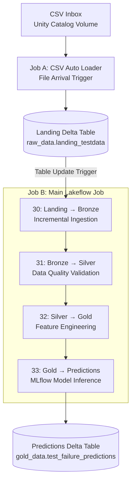

# Streaming Data Architecture
## Overview

The predictive maintenance project implements an event-triggered data pipeline using **Databricks Lakeflow Jobs, Apache Spark Structured Streaming, Delta Lake, Unity Catalog, and MLflow**.

### Technology Stack and Responsibilities

| Technology | Role | Implementation |
|---|---|---|
| **Databricks Lakeflow Jobs** | Workflow orchestration | Coordinates event-triggered CSV ingestion and sequential Bronze → Silver → Gold → Prediction processing. |
| **Apache Spark Structured Streaming** | Incremental processing engine | Processes newly available records using `readStream`, `writeStream`, and persistent checkpoints. |
| **Delta Lake** | Transactional storage layer | Stores landing, Bronze, Silver, Gold, and prediction datasets as Delta tables. |
| **Unity Catalog** | Data governance | Organizes and governs tables, volumes, and model assets through centralized access controls and lineage. |
| **MLflow** | Machine learning lifecycle management | Tracks experiments, stores trained models, and supports model loading for incremental inference. |
| **Databricks Auto Loader** | Incremental file ingestion | Detects and ingests new CSV files using the `cloudFiles` source. |

These technologies operate together to provide an event-driven data engineering and machine learning inference pipeline.

Lakeflow Jobs manages workflow execution, Spark Structured Streaming processes incoming data, Delta Lake provides reliable storage, Unity Catalog governs data assets, and MLflow manages the trained machine learning model used for inference.

The pipeline simulates incoming machine sensor data by introducing CSV files in batches. New records are automatically ingested, validated, transformed into model-ready features, and scored using a previously trained machine learning model (**engineered-feature HistGradientBoosting baseline with a threshold of 0.004751**).

The architecture follows the **Medallion Architecture (Bronze → Silver → Gold)** to separate raw ingestion, data-quality validation, feature engineering, and machine learning inference. Before the Medallion Architecture, a seperate landing area was created to land raw csv files using autoloader

Two independent Lakeflow Jobs are used:

1. **CSV Ingestion Job:** Detects newly arriving CSV files and loads them into a Delta landing table.
2. **Main Processing Job:** Processes new landing records sequentially through Bronze, Silver, Gold, and MLflow inference.

Both jobs use event-based triggers rather than continuously running compute.

## 1. Streaming Architecture Diagram

### Lakeflow Jobs — Streaming Architecture

| Component | Job A — CSV Ingestion | Job B — Data Processing & MLflow Inference |
|---|---|---|
| **Orchestration** | Databricks Lakeflow Jobs | Databricks Lakeflow Jobs |
| **Technology** | Databricks Auto Loader (`cloudFiles`) | Apache Spark Structured Streaming |
| **Connector Type** | Standard file connector | Not applicable |
| **Trigger** | File arrival in Unity Catalog Volume | Landing Delta table update |
| **Execution** | `availableNow=True` | Four sequential notebook tasks (`availableNow=True`) |
| **Architecture** | CSV Inbox → Landing Delta Table | Bronze → Silver → Gold → Predictions |
| **Source** | CSV files in Unity Catalog Volume | Landing Delta table |
| **Destination** | `raw_data.landing_testdata` | `gold_data.test_failure_predictions` |
| **Processing Mode** | Event-triggered incremental ingestion | Event-triggered incremental processing |
| **Checkpointing** | Persistent Structured Streaming checkpoint | Persistent checkpoints for each streaming stage |
| **Compute** | Job-configured compute (serverless if enabled) | Job-configured compute (serverless if enabled) |
| **Declarative Pipeline (SDP)** | No | No |

**Landing Zone:** The CSV inbox serves as the initial file staging location. Auto Loader converts incoming CSV files into Delta records stored in the landing table. This table provides a durable handoff between ingestion and downstream processing, allowing both jobs to operate independently.

**Execution Model:** Both jobs are event-triggered rather than continuously running. Spark processes newly available data and terminates, while Databricks manages the triggers and job orchestration.

Persistent Structured Streaming checkpoints maintain incremental processing progress across executions.

This design avoids the need for continuously running Spark compute while maintaining automated ingestion and inference.

### Data Governance and Compute

Unity Catalog provides centralized data governance, including permissions and lineage tracking.

Databricks Lakeflow Jobs manages workflow orchestration, while the configured job compute executes the processing tasks.

When serverless compute is selected, Databricks automatically provisions and scales the compute resources without requiring manual cluster management.

Auto Loader also supports checkpointing so previously processed files aren't unnecessarily ingested again
All Delta tables are managed through the `predictivemaintenancecatalog` Unity Catalog catalog.

## 2. Job A — CSV Auto Loader Ingestion

**Notebook:** `30_CSV_Inbox_to_Landing`

The ingestion workflow monitors a Unity Catalog Volume for newly arriving CSV files.

**Source directory:**

`/Volumes/predictivemaintenancecatalog/raw_data/landing/csv_inbox`

**Destination Delta table:**

`predictivemaintenancecatalog.raw_data.landing_testdata`

### Ingestion Process

1. New CSV files are placed in the monitored inbox.
2. A Lakeflow file-arrival trigger initiates the ingestion job.
3. Databricks Auto Loader reads newly discovered CSV files using the `cloudFiles` source.
4. Incoming data is validated against the existing landing-table schema.
5. Records are appended to the landing Delta table.
6. A persistent streaming checkpoint tracks ingestion progress.

The Auto Loader is configured with:

- CSV input format and header recognition.
- An explicit schema derived from the landing table.
- Schema evolution configured to fail when unexpected columns are detected.
- A persistent checkpoint for incremental file processing.

This design allows new CSV batches to be processed without manually restarting or executing the downstream notebooks.

## 3. Job B — Main Lakeflow Processing Pipeline

The main Lakeflow Job is triggered when the landing Delta table is updated.

Four notebooks execute sequentially, with each stage depending on the successful completion of the preceding stage.

| Step | Notebook | Source | Destination | Responsibility |
|---|---|---|---|---|
| 30 | Landing → Bronze | `raw_data.landing_testdata` | `bronze_data_not_quality_checked.streaming` | Incremental ingestion and metadata |
| 31 | Bronze → Silver | `bronze_data_not_quality_checked.streaming` | `silver_data.streaming` | Data-quality validation |
| 32 | Silver → Gold | `silver_data.streaming` | `gold_data.streaming` | Filtering and feature engineering |
| 33 | Gold → Predictions | `gold_data.streaming` | `gold_data.test_failure_predictions` | MLflow inference |

### Step 30 — Landing to Bronze

The Bronze stage reads incremental changes from the registered landing Delta table using Spark Structured Streaming.

In addition to preserving the source fields, the pipeline adds metadata for traceability:

- `_ingest_timestamp`: Time of Bronze ingestion.
- `_source`: Source identifier.
- `_source_file`: Source Delta file path.

The resulting records are appended to the Bronze Delta table.

A persistent checkpoint prevents previously processed Delta commits from being reprocessed during normal subsequent executions.

### Step 31 — Bronze to Silver

The Silver stage applies data-quality checks to incoming records.

The validation rules include:

| Feature | Validation Rule |
|---|---|
| `UDI` | Must not be NULL |
| `Type` | Must be L, M, or H |
| `Air_temperature_K` | Greater than 0 |
| `Process_temperature_K` | Greater than 0 |
| `Rotational_speed_rpm` | Greater than 0 |
| `Torque_Nm` | Greater than or equal to 0 |
| `Tool_wear_min` | Greater than or equal to 0 |
| `Machine_failure` | Must be 0 or 1 for the current labeled-data pipeline |

Records are assigned a Boolean `_quality_pass` flag indicating whether they satisfy the validation requirements.

Both valid and invalid records are retained in the Silver table, allowing failed validation checks to be investigated.

A duplicate-UDI diagnostic is also performed, although duplicate removal is not currently enforced by the streaming write.

### Step 32 — Silver to Gold

Only records with `_quality_pass = True` are selected for Gold processing.

The pipeline generates five engineered features using the same calculations adopted during model development.

| Engineered Feature | Calculation |
|---|---|
| `Mechanical_power_W` | (2π / 60) × Rotational_speed_rpm × Torque_Nm |
| `Temperature_difference_K` | Process_temperature_K − Air_temperature_K |
| `Torque_wear` | Torque_Nm × Tool_wear_min |
| `Speed_wear` | Rotational_speed_rpm × Tool_wear_min |
| `Power_wear` | Mechanical_power_W × Tool_wear_min |

The resulting Gold Delta table contains validated operating variables, engineered features, machine identifiers, and the reference failure label used for subsequent evaluation.

This ensures feature-engineering consistency between model development and inference.

### Step 33 — Gold to MLflow Prediction

The final notebook reads newly available records from the Gold table and applies the trained HistGradientBoosting classification model registered in MLflow.

The inference workflow:

1. Loads the selected MLflow model.
2. Retrieves the model's expected feature schema.
3. Verifies that the required features exist in the Gold table.
4. Uses an MLflow Spark UDF to generate predictions.
5. Applies the saved classification threshold.
6. Appends prediction results to the predictions Delta table.

**Prediction destination:**

`predictivemaintenancecatalog.gold_data.test_failure_predictions`

The prediction table includes:

| Column | Description |
|---|---|
| `UDI` | Machine record identifier |
| `Product_ID` | Product identifier, when available |
| `failure_probability` | Estimated probability of machine failure |
| `predicted_failure` | Binary failure classification (0 or 1) |
| `model_uri` | MLflow model identifier |
| `threshold` | Classification threshold used |
| `prediction_timestamp` | Time the prediction was generated |

The selected model uses an optimized classification threshold of approximately **0.004751**, established during validation.

The ground-truth `Machine_failure` label is excluded from model inputs to prevent target leakage.

## 4. Incremental Processing and Checkpointing

Each streaming notebook uses Spark Structured Streaming with a persistent checkpoint.

The pipeline uses the `availableNow=True` trigger, which processes all data available when the streaming query executes and then terminates.

Unlike continuously running streaming applications, compute does not need to remain active between job executions.

Checkpoints maintain streaming progress so that subsequent executions can resume from previously processed data.

The architecture therefore combines:

- **Event-triggered execution:** Jobs start when new files or landing-table updates are detected.
- **Incremental processing:** Only newly available source data is processed during normal operation.
- **Persistent checkpoints:** Streaming progress is maintained across executions.
- **Delta Lake storage:** Tables provide transactional storage between processing stages.
- **Sequential orchestration:** Downstream tasks execute only after their upstream tasks succeed.

The Silver-to-Gold and Gold-to-Prediction streams use `skipChangeCommits=True`. This allows append-oriented processing to continue when source tables have modification commits, but those modifications are skipped rather than automatically propagated downstream.

Consequently, corrections to previously processed records require a separate reconciliation or reprocessing strategy.

## 5. Design Considerations

The current implementation is designed to demonstrate an end-to-end batch-triggered streaming inference workflow using labeled synthetic machine data.

Several operational considerations are important:

- **Labeled data:** The current Silver validation requires a valid `Machine_failure` label. A production inference pipeline would need to support incoming observations without known outcomes.
- **Duplicate handling:** Duplicate UDIs are inspected, but end-to-end uniqueness enforcement is not yet implemented.
- **Data corrections:** Previously processed records modified through Delta updates are not automatically rescored by the current append-oriented streaming configuration.
- **Execution model:** This is triggered incremental processing, not continuous low-latency event streaming.

These distinctions provide a foundation for future enhancements while keeping the present implementation reproducible and easy to operate.

## Summary

The streaming architecture demonstrates how Databricks can integrate automated file ingestion, incremental Delta Lake processing, data-quality validation, feature engineering, and MLflow inference into a unified MLOps workflow.

Separating CSV ingestion from the main processing job provides clear operational boundaries, while sequential Lakeflow orchestration ensures that model inference receives records only after the required upstream transformations have completed.
