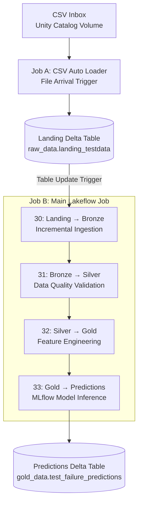

# Streaming Data Architecture
## Overview

The predictive maintenance project implements an event-triggered data pipeline using **Databricks Lakeflow Jobs, Apache Spark Structured Streaming, Delta Lake, Unity Catalog, and MLflow**.

The pipeline simulates incoming machine sensor data by introducing CSV files in batches. New records are automatically ingested, validated, transformed into model-ready features, and scored using a previously trained machine learning model (**engineered-feature HistGradientBoosting baseline with a threshold of 0.004751**).

The architecture follows the **Medallion Architecture (Bronze → Silver → Gold)** to separate raw ingestion, data-quality validation, feature engineering, and machine learning inference. Before the Medallion Architecture, a seperate landing area was created to land raw csv files using autoloader

Two independent Lakeflow Jobs are used:

1. **CSV Ingestion Job:** Detects newly arriving CSV files and loads them into a Delta landing table.
2. **Main Processing Job:** Processes new landing records sequentially through Bronze, Silver, Gold, and MLflow inference.

Both jobs use event-based triggers rather than continuously running compute.

## 1. Streaming Architecture Diagram

### Lakeflow Jobs — Streaming Architecture

| Component | Job A — CSV Ingestion | Job B — Data Processing & MLflow Inference |
|---|---|---|
| **Orchestration** | Databricks Lakeflow Jobs | Databricks Lakeflow Jobs |
| **Technology** | Databricks Auto Loader (`cloudFiles`) | Apache Spark Structured Streaming |
| **Connector Type** | Standard file connector | Not applicable |
| **Trigger** | File arrival in Unity Catalog Volume | Landing Delta table update |
| **Execution** | `availableNow=True` | Four sequential notebook tasks (`availableNow=True`) |
| **Architecture** | CSV Inbox → Landing Delta Table | Bronze → Silver → Gold → Predictions |
| **Source** | CSV files in Unity Catalog Volume | Landing Delta table |
| **Destination** | `raw_data.landing_testdata` | `gold_data.test_failure_predictions` |
| **Processing Mode** | Event-triggered incremental ingestion | Event-triggered incremental processing |
| **Checkpointing** | Persistent Structured Streaming checkpoint | Persistent checkpoints for each streaming stage |
| **Compute** | Job-configured compute (serverless if enabled) | Job-configured compute (serverless if enabled) |
| **Declarative Pipeline (SDP)** | No | No |

**Landing Zone:** The CSV inbox serves as the initial file staging location. Auto Loader converts incoming CSV files into Delta records stored in the landing table. This table provides a durable handoff between ingestion and downstream processing, allowing both jobs to operate independently.

**Execution Model:** Both jobs are event-triggered rather than continuously running. Spark processes newly available data and terminates, while Databricks manages the triggers and job orchestration.

Persistent Structured Streaming checkpoints maintain incremental processing progress across executions.

This design avoids the need for continuously running Spark compute while maintaining automated ingestion and inference.

### Data Governance and Compute

Unity Catalog provides centralized data governance, including permissions and lineage tracking.

Databricks Lakeflow Jobs manages workflow orchestration, while the configured job compute executes the processing tasks.

When serverless compute is selected, Databricks automatically provisions and scales the compute resources without requiring manual cluster management.

Auto Loader also supports checkpointing so previously processed files aren't unnecessarily ingested again
All Delta tables are managed through the `predictivemaintenancecatalog` Unity Catalog catalog.
