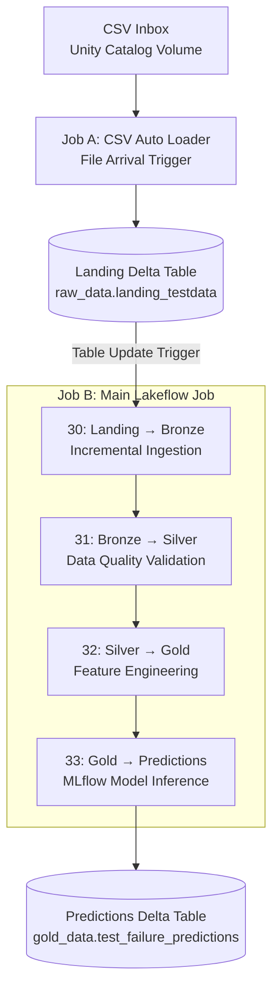

# Streaming Data Architecture
## Overview

The predictive maintenance project implements an event-triggered data pipeline using **Databricks Lakeflow Jobs, Apache Spark Structured Streaming, Delta Lake, Unity Catalog, and MLflow**.

The pipeline simulates incoming machine sensor data by introducing CSV files in batches. New records are automatically ingested, validated, transformed into model-ready features, and scored using a previously trained machine learning model (**engineered-feature HistGradientBoosting baseline with a threshold of 0.004751**).

The architecture follows the **Medallion Architecture (Bronze → Silver → Gold)** to separate raw ingestion, data-quality validation, feature engineering, and machine learning inference.

Two independent Lakeflow Jobs are used:

1. **CSV Ingestion Job:** Detects newly arriving CSV files and loads them into a Delta landing table.
2. **Main Processing Job:** Processes new landing records sequentially through Bronze, Silver, Gold, and MLflow inference.

Both jobs use event-based triggers rather than continuously running compute.

## 1. Streaming Architecture Diagram

All Delta tables are managed through the `predictivemaintenancecatalog` Unity Catalog catalog.
