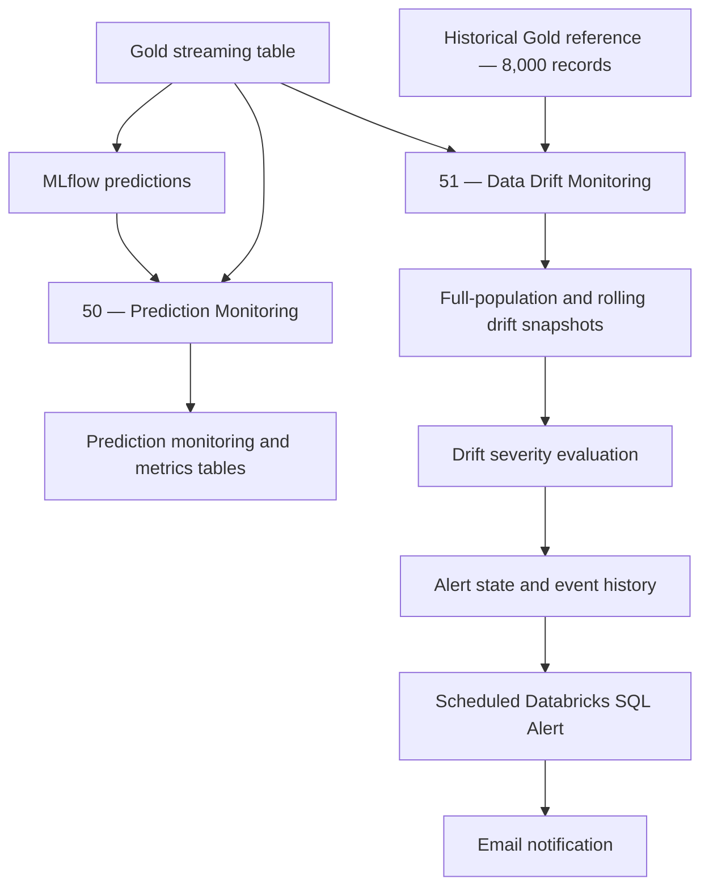

# Prediction Monitoring, Data Drift Detection, and Automated Alerts

## Overview

After records pass through the Bronze → Silver → Gold pipeline and are scored by the MLflow model, a separate monitoring workflow evaluates **model performance**, detects **changes in input-feature distributions**, and maintains a **stateful drift-alert history**.

The implementation uses Databricks notebooks, Unity Catalog Delta tables, PySpark, statistical tests, and Databricks SQL Alerts.

| Component | Implementation | Purpose |
|---|---|---|
| **1. Prediction monitoring** | `50_Prediction_Monitoring` | Compare predictions with known outcomes; calculate overall, batch-level, and rolling classification metrics |
| **2. Data drift monitoring** | `51_Data_Drift_Monitoring` | Compare incoming Gold features against a fixed historical reference using PSI and KS tests |
| **3. Drift alerting** | Notebook 51 + Databricks SQL Alert | Classify drift severity, track alert transitions, and notify on actionable changes |



All table names below belong to the `predictivemaintenancecatalog.gold_data` schema unless otherwise specified.

## 1. Prediction Monitoring

**Notebook:** `50_Prediction_Monitoring`

### Objective
Evaluate classification performance as new **labeled** machine observations become available. Unlike feature-drift monitoring, performance metrics require the actual `Machine_failure` outcome to be known.

Notebook 50 calculates classification performance metrics, including precision, recall, F2 score, true positives (TP), false positives (FP), false negatives (FN), and true negatives (TN).

These metrics are calculated for the cumulative prediction population, individual ingestion batches, and rolling windows of the latest 1,000 labeled observations.

Because the project uses a synthetic dataset with known `Machine_failure` labels, predicted outcomes can be compared directly against actual outcomes. This allows us to evaluate whether model performance changes as additional data is ingested.

**However, these metrics are not currently integrated into the operational monitoring dashboard or automated alerting system.** They are calculated and stored in Databricks for retrospective evaluation and potential future use.

In a real-world predictive maintenance system, actual machine failure outcomes are generally unavailable at prediction time. Consequently, operational monitoring focuses on metrics that do not require ground-truth labels, including:

- Prediction volume and predicted failure rate.
- Failure probability distributions.
- Feature drift using PSI and KS statistics.
- Automated drift detection and alerts.

The retrospective performance calculations demonstrate how model accuracy could be monitored once verified failure outcomes become available. Future enhancements could incorporate delayed-label performance monitoring, performance degradation alerts, and automated model retraining.


### Data sources and processing

| Source | Unity Catalog table | Purpose |
|---|---|---|
| Predictions | `gold_data.test_failure_predictions` | Predicted failure class, probability, model URI, threshold, and prediction timestamp |
| Gold | `gold_data.streaming` | Operating features and actual `Machine_failure` labels |
| CSV inbox | `/Volumes/predictivemaintenancecatalog/raw_data/landing/csv_inbox` | Associate records with the source CSV filename, where applicable |

The notebook joins predictions to Gold on `UDI`, validates uniqueness and label completeness, and assigns each record to its CSV batch. Records without an inbox filename match are classified as `Other / Pre-CSV Data`.

The combined records are **upserted** to `prediction_monitoring` using a Delta `MERGE` keyed by `UDI`. This avoids blindly appending the same machine prediction during repeated monitoring runs, provided each `UDI` is unique.

### Overall, batch-level, and rolling monitoring

| View | Table / calculation | Description |
|---|---|---|
| **Overall performance** | Calculated from `prediction_monitoring` | Cumulative confusion-matrix counts and metrics across available labeled records |
| **Batch performance** | `prediction_monitoring_metrics` | Metrics grouped by CSV batch, `model_uri`, and threshold; upserted when recomputed |
| **Rolling performance** | `prediction_monitoring_metrics_rolling` | Latest **1,000 labeled predictions** per model/threshold, ordered by `prediction_timestamp` and `UDI` |

The rolling-performance notebook also assigns a support status:

- `WARMING_UP`: fewer than 1,000 eligible labeled predictions.
- `LOW_FAILURE_SUPPORT`: 1,000 observations are available, but fewer than 20 actual failures are present.
- `READY`: 1,000 observations and at least 20 actual failures are available.

Rolling snapshots are stored only when the latest window or its confusion-matrix values change. These metrics describe the most recent **1,000 records**, not a 1,000-minute or 1,000-day time interval.

> **Scope:** Because the present simulation provides ground-truth labels, recall, precision, and F2 can be calculated. In production, these metrics would be delayed until actual failure outcomes became available.

The overall, batch-level, and rolling classification metrics are calculated using known failure labels from the synthetic dataset.

These metrics are generated after model inference by joining stored predictions with their corresponding actual outcomes using `UDI`.

They are intended to evaluate model performance across successive data batches and identify potential performance degradation.

Importantly, these metrics are not used to generate predictions, modify the selected classification threshold, or trigger operational alerts.

In a real-world deployment, the same evaluations would only be possible after actual failure outcomes became available. Until then, operational monitoring relies on prediction statistics and feature drift measurements that do not require ground-truth labels.

## 2. Data Drift Monitoring

**Notebook:** `51_Data_Drift_Monitoring`

### Objective

Detect whether incoming machine operating conditions have changed relative to the historical reference population used for monitoring. Feature drift can indicate new operating regimes, sensor changes, or data quality problems; **drift alone does not establish that predictive performance has deteriorated**.

### Reference and monitoring populations

| Dataset | Unity Catalog table | Usage |
|---|---|---|
| **Fixed reference population** | `gold_data.all_features` | 8,000 historical records used to build reference distributions |
| **Incoming/current population** | `gold_data.streaming` | Accumulated incoming Gold records |
| **Recent population** | Latest 1,000 rows from `gold_data.streaming` | Rolling drift window, ordered by `_gold_processed_at` and then `UDI` |

The reference is intentionally fixed so subsequent monitoring windows can be compared consistently. It is **not** the 1,600-record validation split.

The notebook monitors **11 model-input features**: one categorical (`Type`), five original numeric features, and five engineered numeric features.

| Original input features | Engineered features |
|---|---|
| `Type` | `Mechanical_power_W` |
| `Air_temperature_K` | `Temperature_difference_K` |
| `Process_temperature_K` | `Torque_wear` |
| `Rotational_speed_rpm` | `Speed_wear` |
| `Torque_Nm` | `Power_wear` |
| `Tool_wear_min` | — |

### Drift detection methods

| Method | Applied to | Purpose |
|---|---|---|
| **Population Stability Index (PSI)** | All 11 features | Quantifies differences between the historical and current feature distributions |
| **Two-sample Kolmogorov–Smirnov (KS) test** | 10 numeric features | Measures the maximum difference between empirical cumulative distributions and reports a p-value |

Numerical PSI uses approximately ten quantile-based bins derived from the historical reference data. Those same bin boundaries are used for incoming observations. Categorical PSI compares the distribution of `Type` values, including an `__OTHER__` bucket for previously unseen categories.

For numeric features, a KS p-value below `0.05` is marked as statistically significant. KS is supplementary evidence; the **PSI threshold determines the severity category** in this implementation.

### PSI drift thresholds

| PSI value | Internal PSI status | Alert severity | Interpretation |
|---|---|---|---|
| `< 0.10` | `STABLE` | `NORMAL` | No material drift detected by the selected PSI threshold |
| `0.10` to `< 0.25` | `MODERATE_DRIFT` | `WARNING` | Review distribution changes and monitor subsequent windows |
| `>= 0.25` | `SIGNIFICANT_DRIFT` | `HIGH` | Investigate changes in data, sensors, operating conditions, and possible model impact |

These cutoffs are **monitoring heuristics**, not guarantees of model degradation or formal statistical confidence levels.

### Drift result tables

| Delta table | Purpose |
|---|---|
| `prediction_monitoring_drift_reference` | Stored historical bin boundaries, categories, and reference proportions |
| `prediction_monitoring_drift` | Drift results against the full accumulated incoming population |
| `prediction_monitoring_drift_rolling` | Drift results for the most recent 1,000 incoming Gold records |

The drift result tables store monitoring identifiers, feature names, PSI/KS metrics, severity labels, timestamps, and window metadata. Results are inserted by `monitoring_run_id` and `feature`, allowing repeated executions for the same snapshot to avoid duplicate metric rows.

> **Window distinction:** Rolling prediction performance uses the latest 1,000 **labeled predictions**. Rolling feature drift uses the latest 1,000 **Gold observations**. They answer different questions and do not necessarily contain exactly the same records.

## 3. Drift Alert Management and Notification

**Implemented in:** `51_Data_Drift_Monitoring` plus the Databricks SQL Alert configured in the workspace.

### Objective

Turn drift measurements into actionable notifications while avoiding a new email every time a feature remains in the same drift state.

The notebook first maps PSI categories to `NORMAL`, `WARNING`, and `HIGH`, then maintains the current alert state of each monitored feature across successive monitoring runs.

### Alert lifecycle

| Previous condition | New condition | Event / transition | Notification required |
|---|---|---|---|
| No active alert | WARNING or HIGH | `NEW_ALERT` | Yes |
| WARNING | HIGH | `ESCALATED` | Yes |
| HIGH | HIGH | `CONTINUING` | No |
| HIGH | WARNING | `DOWNGRADED` | No |
| OPEN | First consecutive NORMAL window | `RECOVERY_PENDING` | No |
| RECOVERY_PENDING | Second consecutive NORMAL window | `RESOLVED` | Yes |
| RECOVERY_PENDING | WARNING or HIGH | `REOPENED` | Yes |

Two consecutive normal monitoring windows are required before an active drift alert is resolved. This reduces notification noise from one-off changes in PSI.

### Alert storage

| Delta table | Purpose |
|---|---|
| `prediction_monitoring_drift_alerts` | Per-feature drift evaluation history for each monitoring run |
| `prediction_monitoring_drift_alert_state` | Latest state, severity, transitions, and consecutive normal-window count for each feature |
| `prediction_monitoring_drift_alert_events` | Event history and notification flags/statuses for significant state transitions |

Events are assigned a deterministic `event_id` and merged into the events table to avoid inserting the same event more than once for a given run, feature, and transition.

### SQL alert notification query

The scheduled SQL Alert reads actionable events where `notification_required = TRUE` and `notification_status = 'PENDING'`.

The following query preserves a descriptive **no-pending-events** row when the event table has nothing to report, while providing a separate numeric column for the alert condition:

```sql
WITH pending_events AS (
    SELECT
        feature,
        severity,
        ROUND(psi, 4) AS psi,
        ks_pvalue,
        recommended_action,
        event_timestamp
    FROM predictivemaintenancecatalog.gold_data.prediction_monitoring_drift_alert_events
    WHERE notification_required = TRUE
      AND notification_status = 'PENDING'
)
SELECT
    feature, severity, psi, ks_pvalue,
    recommended_action, event_timestamp,
    1 AS has_pending_event
FROM pending_events

UNION ALL

SELECT
    '(no pending drift events)' AS feature,
    'NONE' AS severity,
    0.0 AS psi,
    CAST(NULL AS DOUBLE) AS ks_pvalue,
    'No action required' AS recommended_action,
    current_timestamp() AS event_timestamp,
    0 AS has_pending_event
WHERE NOT EXISTS (SELECT 1 FROM pending_events)

ORDER BY has_pending_event DESC, psi DESC;
```

Configure the SQL Alert condition as **first row of `has_pending_event` > 0** (without a COUNT aggregation). This produces a positive signal when pending events exist, while the fallback row produces zero and does not trigger the alert. The nonaggregated query also preserves feature-level details that can be included in an alert email template.

> **Important:** Using `COUNT(feature) > 0` with a fallback row is incorrect: the fallback itself has a non-null `feature`, making the count positive even when no real event is pending.

### Notification lifecycle and scheduling

The notebook references a Databricks SQL Alert named `60_Predictive_Maintenance_Alert`, evaluated every **10 minutes**. Its notification-maintenance step uses a **one-hour grace period** before changing older `PENDING` events to `SENT` and updating notification timestamps.

This delay is intended to give the scheduled SQL Alert time to evaluate the pending events before they are retired. It does **not** verify actual email delivery: `SENT` means the notebook advanced the event's notification status after the grace period.

The SQL Alert's schedule, subscribers, and repeat-notification behavior are configured in Databricks, separately from the notebook. These settings should be checked after deployment to confirm that new events are reported even when an earlier alert remains active.

## 4. Monitoring Tables Summary

| Table (within `gold_data`) | Owner / role |
|---|---|
| `prediction_monitoring` | Labeled prediction-level monitoring records |
| `prediction_monitoring_metrics` | Batch/model-level classification metrics |
| `prediction_monitoring_metrics_rolling` | Recent 1,000-record performance snapshots |
| `prediction_monitoring_drift_reference` | Fixed feature-reference distributions |
| `prediction_monitoring_drift` | Full-population feature drift snapshots |
| `prediction_monitoring_drift_rolling` | Rolling 1,000-record feature drift snapshots |
| `prediction_monitoring_drift_alerts` | Drift evaluation history |
| `prediction_monitoring_drift_alert_state` | Current feature-level alert state |
| `prediction_monitoring_drift_alert_events` | Alert event and notification history |

## 5. Operational Considerations

- **Model evaluation requires labels.** Unlabeled production observations can be scored and monitored for feature drift, but recall and precision require subsequently confirmed outcomes.
- **Reference drift is not the same as model-performance drift.** PSI and KS measure changes in feature distributions; they do not directly measure a decline in recall or F2.
- **Window support matters.** The `LOW_FAILURE_SUPPORT` flag cautions against overinterpreting recall from a small number of failures.
- **Repeated runs are controlled.** Delta `MERGE` operations and deterministic run/event identifiers reduce duplicate monitoring records, though they do not replace upstream UDI uniqueness requirements.
- **Notification statuses require care.** The current one-hour retirement mechanism is an operational approximation, not an acknowledgment from the email service.

## Summary

The monitoring workflow complements incremental MLflow inference with three capabilities: **performance evaluation against known outcomes**, **fixed-baseline and rolling feature drift detection**, and **stateful alerting through Databricks SQL Alerts**. Together, they support investigation of changing equipment behavior and the reliability of the predictive maintenance system over time.