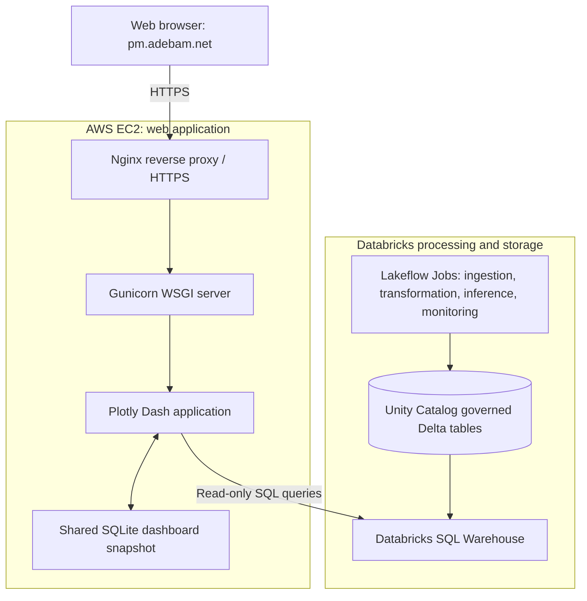

# Predictive Maintenance Dashboard and AWS EC2 Deployment

**Live application:** [https://pm.adebam.net/](https://pm.adebam.net/)  
**Application source:** [`Predictive_Maintenance/Dash/`](../Dash/)

## 1. Overview

This component provides a browser-based **predictive maintenance monitoring dashboard**, built with **Plotly Dash** and deployed on **AWS EC2**. It presents predictions, model behavior, rolling feature drift, and drift-alert history generated by the Databricks pipeline.

The dashboard is a **read-only visualization layer**: the Databricks notebooks and Lakeflow Jobs perform ingestion, inference, drift calculations, and alert generation. The web application queries the resulting Delta tables through a **Databricks SQL Warehouse**; it does not execute the MLflow model or start the upstream jobs.

The application has four tabs: **Overview**, **Predictions**, **Drift Monitoring**, and **Alert Management**.

## 2. System Architecture



*Browser requests pass through Nginx and Gunicorn to Dash. The Dash server independently queries the SQL Warehouse; the SQL Warehouse reads the governed Delta tables.*

| Technology | Responsibility in this application |
|---|---|
| **Plotly Dash / Plotly** | Python dashboard, interactive plots, tabs, filters, and callbacks |
| **Databricks SQL Connector / SQL Warehouse** | Read-only queries against Delta tables and Databricks system tables |
| **Unity Catalog / Delta Lake** | Governed storage for prediction, feature, drift, and alert records |
| **AWS EC2** | Host running the dashboard process and web-server components |
| **Gunicorn** | Serves the Dash Flask/WSGI application with worker processes |
| **Nginx** | Accepts public HTTPS requests and reverse-proxies to Gunicorn on localhost |
| **SQLite snapshot + short-lived query cache** | Reuses the loaded data across Gunicorn workers; reduces warehouse queries |

## 3. Dashboard Features

### 3.1 Overview

The **Overview** tab provides an operational summary of the latest loaded data:

- **Prediction activity KPIs:** unique monitored UDIs and predicted failure counts.
- **Feature-health KPIs:** counts of features in moderate and significant PSI drift categories.
- **Alert and pipeline KPIs:** active drift alerts and most recent completed Lakeflow run outcomes.
- **Feature behavior by ingestion time:** median values with P10–P90 bands, distinguished by CSV ingestion batch.
- **Prediction volume over time:** number of records scored in time buckets (linear/log Y-axis selector).
- **Model behavior over time:** predicted failure rate and failure-probability summaries (median and P95).
- **Current feature drift:** latest PSI by monitored feature.
- **Lakeflow execution history:** most recent completed runs of configured jobs.

**Time interpretation:** The feature-trend X-axis is derived from Bronze `_ingest_timestamp` metadata. It reflects **ingestion/file timing**, not an original sensor event timestamp. Prediction charts use `prediction_timestamp`.

### 3.2 Predictions

The **Predictions** tab focuses on the model's stored inference outputs:

- Prediction count, predicted failure count, predicted failure rate, and median stored threshold.
- **Failure-probability histogram**, with the stored decision threshold indicated.
- A **prediction-time slider** that filters the histogram only; it does not filter the tab's other KPIs, risk ranking, or register.
- **Top 15 highest-risk machines**, ranked by failure probability.
- **Prediction register**, searchable, sortable, and filterable by UDI, probability, classification, and timestamp.

**Important:** Predicted failure rate is the fraction **flagged by the model**, not the observed equipment failure rate.

### 3.3 Drift Monitoring

The **Drift Monitoring** tab compares incoming operating conditions with the fixed historical reference population:

- Stable, moderate, and significant drift feature counts.
- Latest **PSI by feature**, with thresholds of `0.10` and `0.25`.
- **Rolling PSI history** for features currently showing significant drift.
- **Boxplot and smooth density (KDE) comparison** of reference versus current feature values.
- Per-feature drift statistics, including PSI, KS statistic, and KS p-value where applicable.

The reference contains **8,000 historical records** (training and validation population). The current distribution uses the **latest 1,000 Gold observations**, ordered by `_gold_processed_at DESC, UDI DESC`, consistent with the rolling drift calculation in Notebook 51.

| PSI range | Dashboard classification |
|---|---|
| `< 0.10` | Stable |
| `0.10` to `< 0.25` | Moderate drift |
| `>= 0.25` | Significant drift |

The 11 monitored features include **10 numerical** features and categorical `Type`. The categorical feature appears in PSI monitoring but is excluded from numeric-only boxplots and density curves.

PSI measures distribution shift; KS statistics and p-values offer a complementary comparison. **Feature drift does not automatically establish a decline in prediction accuracy.**

### 3.4 Alert Management

The **Alert Management** tab is a read-only view of the drift-alert lifecycle:

- New alert event count and current open, acknowledged, or resolved state counts.
- Selectable alert inbox and detail panel.
- Alert event history, including severity, timestamps, and notification status.

**Alert creation, email notification, lifecycle transitions, and recovery logic run in Databricks**, not in the dashboard. Acknowledgment and resolution controls are not active in this version; the UI does not modify alert records.

## 4. Dashboard Visualizations and Exact Databricks Sources

The application source is [`Dash/data.py`](../Dash/data.py) (SQL queries), [`Dash/app.py`](../Dash/app.py) (visualizations), and [`Dash/config.py`](../Dash/config.py) (table configuration).

All table names below belong to the `predictivemaintenancecatalog` catalog unless otherwise indicated.

| Tab | Visualization or information | Unity Catalog source(s) | How the data is used |
|---|---|---|---|
| **Overview** | Machines monitored / predicted failures KPIs | `gold_data.test_failure_predictions` | Unique `UDI` and sum of `predicted_failure` in loaded predictions |
| **Overview** | Feature behavior by ingestion time and CSV batch | `gold_data.streaming` + `bronze_data_not_quality_checked.streaming` + `gold_data.prediction_monitoring` | Gold feature values joined by `UDI` to Bronze `_ingest_timestamp` and monitoring `batch` |
| **Overview** | Prediction volume over time | `gold_data.test_failure_predictions` | Count by `prediction_timestamp` time bucket |
| **Overview** | Model behavior over time | `gold_data.test_failure_predictions` | Predicted failure rate, median score, and P95 score by prediction time bucket |
| **Overview** | Current PSI by feature / drift status KPIs | `gold_data.prediction_monitoring_drift_rolling` | Latest complete rolling monitoring snapshot per feature |
| **Overview** | Active alerts / alert counts | `gold_data.prediction_monitoring_drift_alert_state` + `gold_data.prediction_monitoring_drift_alert_events` (and `gold_data.prediction_monitoring_drift_alerts` for fallback records) | Current alert lifecycle and new-event counts |
| **Overview** | Recent Lakeflow Job execution history | `system.lakeflow.job_run_timeline` + `system.lakeflow.jobs` | Latest completed run and available job metadata for configured IDs |
| **Predictions** | KPIs, probability histogram, stored threshold | `gold_data.test_failure_predictions` | Failure probability, predictions, threshold and timestamp |
| **Predictions** | Highest-risk machines (top 15) | `gold_data.test_failure_predictions` | Records ranked by failure probability |
| **Predictions** | Searchable prediction register | `gold_data.test_failure_predictions` | Stored prediction rows, model URI, UDI and time |
| **Drift Monitoring** | PSI bar chart, severity counts, drift statistics table | `gold_data.prediction_monitoring_drift_rolling` | Latest result for each monitored feature |
| **Drift Monitoring** | Historical PSI trend | `gold_data.prediction_monitoring_drift_rolling` | Consecutive rolling 1,000-record PSI snapshots |
| **Drift Monitoring** | Reference/current boxplots and density curves | `gold_data.all_features` + `gold_data.streaming` | Fixed 8,000-row reference versus latest 1,000 Gold records |
| **Alert Management** | Current alert inbox and details | `gold_data.prediction_monitoring_drift_alert_state` (with alert-record fallback) | Current severity, status, PSI, detected time and transition information |
| **Alert Management** | Event history and notification status | `gold_data.prediction_monitoring_drift_alert_events` | Alert lifecycle events and notification outcomes |

**Population and sampling notes:**

- The Predictions page loads **up to 5,000 most recent prediction rows**, not necessarily the full history.
- The historical reference query loads up to 10,000 rows; the project's reference population is **8,000**.
- The current distribution query uses **the most recent 1,000 Gold rows by Gold processing time**. This is different from the up-to-5,000 Gold-row sample used for the feature trend.
- Rolling PSI history is read from `prediction_monitoring_drift_rolling`; it is **not** assembled from the cumulative drift table `prediction_monitoring_drift`.
- Lakeflow system tables show the most recent **completed** execution and can lag behind the current Jobs UI. They are not a live running/queued status feed.

## 5. How the Dashboard Retrieves and Refreshes Data

1. On first page access, the Dash server runs **read-only SQL `SELECT` statements** against the configured Databricks SQL Warehouse.
2. Query results are assembled into one dashboard snapshot and persisted in a **local SQLite database**, shared by Gunicorn workers on the EC2 machine.
3. Switching tabs, changing numeric features, and adjusting chart controls reuse that snapshot. They do **not** query Databricks again.
4. **Refresh Data** explicitly reloads the SQL results and replaces the snapshot.
5. If a refresh encounters source errors and a previous fully successful snapshot exists, the app preserves the earlier result and shows a warning. Initial partial loads show diagnostics.

A short-lived in-process SQL result cache is also configured (`QUERY_CACHE_SECONDS`, default `45`), but it is **not a scheduled refresh mechanism**.

The dashboard does **not** run Auto Loader, trigger Lakeflow Jobs, change Delta tables, or generate new predictions when a visitor opens it.

## 6. Local Setup

From the repository root:

```bash
cd Predictive_Maintenance/Dash
python3 -m venv .venv
source .venv/bin/activate
pip install -r requirements.txt
cp .env.example .env
```

For a demonstration without a Databricks connection, keep `DEMO_MODE=true` and run:

```bash
python app.py
```

Then open `http://127.0.0.1:8050`.

To connect to live Databricks data, set `DEMO_MODE=false` and configure the workspace hostname, SQL Warehouse HTTP path, and credentials in `.env`. Do **not** commit `.env` or credentials to GitHub.

```dotenv
DEMO_MODE=false
DATABRICKS_SERVER_HOSTNAME=your-workspace-host.cloud.databricks.com
DATABRICKS_HTTP_PATH=/sql/1.0/warehouses/your-warehouse-id

# Choose one authentication method:
DATABRICKS_TOKEN=
# Or, preferably for unattended hosting, a dedicated service principal:
DATABRICKS_CLIENT_ID=
DATABRICKS_CLIENT_SECRET=
```

For local connection verification:

```bash
python test_connection.py
```

The Databricks identity must have permission to use the SQL Warehouse and read the relevant Unity Catalog tables. Displaying Lakeflow job history additionally requires access to the queried `system.lakeflow` tables.

## 7. AWS EC2 Web Deployment

The project uses an **AWS EC2-hosted Dash web application** exposed at [https://pm.adebam.net/](https://pm.adebam.net/).

### Request path

```text
Browser (HTTPS, pm.adebam.net)
    -> Nginx (public reverse proxy / TLS termination)
    -> Gunicorn (127.0.0.1:8050)
    -> Plotly Dash (app.py)
    -> Databricks SQL Warehouse (outbound, read-only SQL)
    -> Unity Catalog Delta tables
```

An example Gunicorn command from the `Dash` directory is:

```bash
gunicorn app:server --bind 127.0.0.1:8050 --workers 2 --timeout 120
```

`app:server` refers to the Flask/WSGI server exposed by `app.py`. Gunicorn serves the Python process; Nginx routes external HTTPS requests to that local port. The deployment does **not** require FastAPI for this dashboard.

**Operational considerations:**

- Configure a process supervisor or service manager to start Gunicorn after reboots and restart it if the process stops.
- Configure DNS so `pm.adebam.net` resolves to the EC2 host, and configure HTTPS/TLS in Nginx.
- Restrict public access to ports **80/443** as needed; do **not** expose Gunicorn's port `8050` directly to the internet. Restrict SSH access.
- Keep Databricks credentials in server-side secrets/environment configuration; do not expose them to the browser.
- Prefer a dedicated **service principal with OAuth machine-to-machine authentication** and read-only data permissions for unattended deployment.
- Protect the SQLite snapshot directory (`.dash_cache/` or `DASH_CACHE_DIR`) so it is writable only by the application account and is never publicly served.
- Apply suitable authentication, access controls, and rate limiting for public-facing use. SQL Warehouse usage and manual refreshes may incur costs.

*Specific Nginx, TLS certificate, system service, firewall, and EC2 configuration values are environment-specific and are not checked into this repository. The command and controls above document the deployment pattern, not a verified copy of the live host's configuration.*

## 8. Testing

The Dash repository includes Python tests for page rendering, data-source mappings, chart behavior, manual refresh, and pipeline-status presentation.

```bash
cd Predictive_Maintenance/Dash
python -m pytest -q
```

These tests do not by themselves establish that every live Databricks permission, warehouse connection, DNS record, or web-server configuration is correct. Those require integration and deployment checks.

## 9. Interpretation and Scope

**Model behavior is not the same as model performance.** The live dashboard shows prediction volume, predicted failure rate, median/P95 scores, feature distributions, PSI/KS drift and alert state. It does **not** display live precision, recall, F2, or actual-versus-predicted confusion matrices.

Notebook 50 separately calculates retrospective classification metrics from the synthetic dataset's known `Machine_failure` labels. Real-world outcomes are generally not known when a prediction is generated; accurate operational performance monitoring would require validated outcomes arriving later.

The dashboard is an **operational visualization and monitoring interface**, not an on-demand prediction form or a tool for acknowledging or resolving alerts. Those capabilities would require separate authenticated application workflows and backend integrations.

