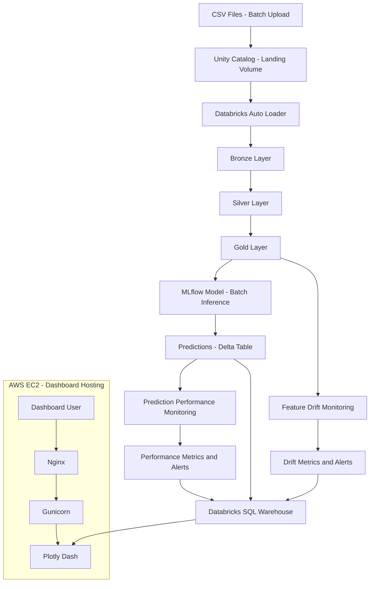
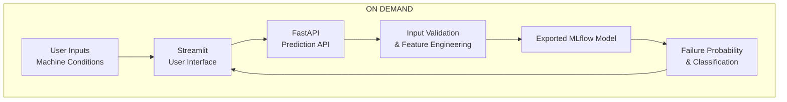

# Predictive Maintenance and Machine Failure Prediction

## Project overview

This project develops an end-to-end predictive maintenance workflow
using Databricks. The objective is to identify machines at risk of
failure from their operating conditions while demonstrating a practical
data engineering, machine learning, monitoring, and application
deployment architecture.

The project combines data ingestion, data quality validation,
exploratory analysis, feature engineering, model training, threshold
optimization, batch/streaming inference, prediction monitoring, feature
drift monitoring, alert generation, and dashboard development.

The intended application prioritizes identifying failures while keeping
unnecessary maintenance alerts manageable. Because failures are
relatively rare, overall accuracy is not sufficient for model
evaluation. The modeling workflow emphasizes recall, precision, F2
score, and alert rate.

The deployment is configured in two parts:

1. **Batch Deployment (Databricks):** Input data is uploaded in batches of CSV files to a landing volume. Databricks Auto Loader ingests the files, and Lakeflow Jobs orchestrate processing through the Bronze, Silver, and Gold layers before generating predictions using the trained MLflow model. Prediction and drift monitoring are also automated.  
   - [Source Code](https://github.com/adebam/DataBricks_Predictive_Maintenance/tree/main/Predictive_Maintenance)
   - [Live Dashboard](https://pm.adebam.net/)

2. **On-Demand Deployment (FastAPI + Streamlit):** A separate application allows users to enter individual machine operating conditions and obtain immediate failure predictions through a Streamlit interface powered by a FastAPI prediction service.  
   - [Source Code](https://github.com/adebam/DataBricks_Predictive_Maintenance/tree/feature/predictive-maintenance-on-demand/apps/Predictive_Maintenance_on_demand)
  
## The Business Case: Turning Equipment Data into Actionable Maintenance Decisions
<p align="center">
  <br>
  <i>Figure 1: From Alarm Overload to AI Maintenance</i>
</p>

In industrial operations, equipment failures can result in unplanned downtime, production losses, costly repairs, and inefficient allocation of maintenance resources.

Traditional maintenance approaches often rely on scheduled inspections, predefined maintenance intervals, and reactive responses to equipment alarms. Although sensors continuously generate valuable operational data, identifying early signs of failure and determining which equipment requires attention can be challenging.

**The objective of this project was to bridge that gap.**

By applying machine learning to equipment sensor data, the solution identifies patterns associated with machine failure and estimates the probability of failure before maintenance decisions are made.

The solution provides:

- **Early failure detection:** Identify equipment exhibiting patterns associated with potential failure.
- **Risk-based prioritization:** Rank equipment according to predicted failure risk rather than treating every alarm equally.
- **Actionable insights:** Present failure probabilities and supporting sensor indicators to help engineers investigate potential problems.
- **Continuous monitoring:** Track prediction behavior and changes in sensor distributions to identify potential model or operational drift.
- **Operational visibility:** Provide a centralized dashboard for monitoring equipment predictions, alerts, and system performance.

### Business Value

The ultimate value is not simply predicting that a machine might fail. It is giving maintenance teams better information to decide **which equipment needs attention, when to investigate, and where to prioritize limited resources.**

The intended business outcomes are fewer unexpected equipment failures, better maintenance planning, reduced unnecessary inspections, and improved equipment reliability.
  
## Dashboard Hosting Decision
The Plotly Dash application was deployed on AWS EC2 rather than Databricks because of the hosting limitations of Databricks Free Edition, which does not provide persistent application hosting. EC2 provides an independent hosting environment, with Gunicorn serving the Dash application and Nginx acting as a reverse proxy. The dashboard connects to Databricks SQL Warehouse to retrieve prediction, monitoring, and alert data.


## Batch Deployment (Databricks)
### End-to-end solution



The project is organized into several connected components:

1.  **Data ingestion and processing:** landing data is ingested into
    Bronze, validated and transformed through Silver, and prepared in
    Gold. (Notebook 0 to 10, & 30 to 32)
2.  **Model development:** models are trained and evaluated, with
    threshold selection emphasizing high failure recall.(Notebook 20 & 21)
3.  **Inference:** incoming machine observations are scored using the
    registered MLflow model. (33)
4.  **Monitoring:** prediction behavior and feature distributions are
    monitored over time.(50 & 51)
5.  **Alerting:** drift events are evaluated and recorded for
    operational review.(60)
6.  **Dashboard:** a Plotly Dash application presents predictions,
    drift, alerts, and pipeline status. It is hosted on AWS EC2 using
    Gunicorn and Nginx. 

### CI/CD architecture

The repository currently has two separate delivery pipelines. They serve
different purposes and should not be treated as one deployment process.

#### 1. Databricks DEV deployment

The Databricks Asset Bundle and its CI/CD workflow currently live on the
`feature/databricks-bundles` branch.

-   GitHub Actions runs Python tests and validates the Databricks DEV
    Asset Bundle.
-   On a push to `feature/databricks-bundles`, the workflow
    automatically deploys the bundle to the DEV Databricks workspace.
-   The bundle uses the `predictivemaintenance_dev` catalog.
-   The deployed resources include the landing-to-Bronze,
    Bronze-to-Silver, Silver-to-Gold, Gold-to-prediction,
    prediction-monitoring, and data-drift-monitoring jobs.
-   Bundle deployment updates job definitions; it does not automatically
    execute the jobs.

**Production Databricks deployment is not configured.** The current
Asset Bundle defines only a `dev` target. A separate manual production
workflow with approval gates is documented in [CI/CD Architecture and
Production Release
Design](Predictive_Maintenance/docs/05_CI_CD_Architecture_and_Production_Governance.md).

#### 2. Dash deployment to AWS EC2

The Dash application is deployed separately from the Databricks jobs.

-   Dash CI runs dashboard syntax checks and tests for pull requests and
    pushes to `main`.
-   After an eligible successful Dash CI run on `main`, Dash CD assumes
    an AWS role through GitHub OIDC.
-   AWS Systems Manager sends the deployment command to the EC2
    instance.
-   The remote deployment checks the commit, working tree, service
    health, and fast-forward eligibility before updating the
    application.
-   It restarts the service, checks the application endpoint, and
    attempts to roll back if the update fails.

**The current EC2 deployment is automatic after eligible successful CI
runs on `main`.** It does not yet have a GitHub Environment approval
gate.

#### Workflow inventory

  ---------------------------------------------------------------------
  Workflow                           Purpose
  ---------------------------------- ----------------------------------
  `databricks-ci.yml`                Tests, validates, and deploys the
                                     Databricks DEV Asset Bundle.
                                     Currently on
                                     `feature/databricks-bundles`.

  `dash-ci.yml`                      Tests the Dash application.

  `dash-deploy.yml`                  Deploys the tested Dash commit to
                                     AWS EC2 through OIDC and SSM.

  `aws-oidc-test.yml`                Manually tests AWS OIDC
                                     authentication.

  `aws-ssm-test.yml`                 Manually tests AWS Systems Manager
                                     connectivity.
  ---------------------------------------------------------------------

### Branch and release status

-   `main` is the repository's default branch and is currently used by
    the Dash CI/CD pipeline.
-   `feature/databricks-bundles` contains the Databricks Asset Bundle,
    Databricks CI workflow, and the reorganized notebook/job resources.
    This work has not yet been merged into `main`.
-   Databricks DEV deployment is automated; Databricks production
    deployment is not enabled.
-   Production deployment should require a reviewed change, a manual
    release action, and an approval gate.

### Security and deployment governance

The Dash deployment already includes useful safeguards such as OIDC
authentication, commit verification, clean-working-tree checks,
fast-forward-only updates, health checks, serialized deployments, and
rollback attempts.

The CI/CD review also identified controls that should be completed
before production Databricks deployment: branch protection, immutable
action pinning, verification of AWS and Databricks service-principal
permissions, separation of test and deployment roles, and a protected
production GitHub Environment.

See [CI/CD Architecture, Security Review, and Production Release
Design](Predictive_Maintenance/docs/05_CI_CD_Architecture_and_Production_Governance.md)
for the detailed workflow diagrams, security findings, and proposed
production release process.

## On-demand inference application



A separate FastAPI and Streamlit application provides on-demand machine failure prediction using the exported MLflow model.


The application is organized into several components:

1. **User interface:** Streamlit provides an interactive interface for entering six machine operating parameters and viewing predictions.
2. **Prediction API:** FastAPI exposes a `/predict` endpoint to receive prediction requests and return results. Uvicorn serves the API.
3. **Input validation and feature engineering:** Pydantic validates incoming inputs, while five additional features are calculated to match the model's training requirements.
4. **Model inference:** The exported MLflow model is loaded at API startup and used to generate failure probabilities and binary classifications.
5. **Visualization:** The application includes a historical training-data pair plot to explore relationships between machine operating conditions and failures.


See the [On-Demand Predictive Maintenance Application](apps/Predictive_Maintenance_on_demand/README.md) for its architecture, installation, API endpoints, and startup instructions.

## Project Tree
```text
DataBricks_Predictive_Maintenance/
├── README.md
├── LICENSE
├── .gitignore
├── From Alarm Overload to AI Maintenance.png
│
├── Predictive_Maintenance/                     # Databricks batch pipeline
│   ├── 00_From Raw to Bronze.ipynb
│   ├── 01_Bronze to Silver.ipynb
│   ├── 02_silver to gold.ipynb
│   ├── 10_Data Exploration Notebook.ipynb
│   ├── 20_Machine_failure_original_features.ipynb
│   ├── 21_Machine_failure_engineered_features.ipynb
│   ├── 30_CSV_Inbox_to_Landing.ipynb
│   ├── 33_Test Data_Gold _MLflowPrediction.ipynb
│   ├── 50_Prediction_Monitoring.ipynb
│   ├── 51_Data_Drift_Monitoring.ipynb
│   ├── 60_Predictive_Maintenance_Alert.dbalert.json
│   ├── ...
│   ├── Dash/                                  # Batch monitoring dashboard
│   │   ├── app.py
│   │   ├── config.py
│   │   ├── data_access.py
│   │   ├── requirements.txt
│   │   ├── README.md
│   │   ├── assets/
│   │   │   └── style.css
│   │   ├── tests/
│   │   │   ├── test_dashboard.py
│   │   │   └── ...
│   │   └── ...
│   └── docs/                                  # Architecture and pipeline guides
│       ├── 00_Dataset_and_data_ingestion.md
│       ├── 01_Machine_failure_Model_development.md
│       ├── 02_Streaming_Data_Architecture.md
│       ├── 03_Prediction_Monitoring_Drift_and_Alerts.md
│       ├── 04_Dashboard_and_AWS_Deployment.md
│       ├── 05_CI_CD_Architecture_and_Production_Governance.md
│       └── pics/
│           └── ...
│
├── apps/
│   └── Predictive_Maintenance_on_demand/       # Single-machine failure prediction
│       ├── streamlit_app.py                    # User interface
│       ├── fast_api_app.py                     # Prediction API
│       ├── feature_engineering.py
│       ├── schemas.py
│       ├── requirements.txt
│       ├── README.md
│       ├── data/
│       │   ├── plotting_data.csv
│       │   ├── plotting_data.parquet
│       │   └── ...
│       └── ...
│
├── AWS_Fast_API_Streamlit_deployment/          # Exported model and deployment files
│   ├── Boto3.ipynb
│   ├── pm_hgb_model_export.zip
│   └── pm_hgb_model_export/
│       ├── MLmodel
│       ├── python_model.pkl
│       ├── requirements.txt
│       ├── metadata/
│       └── ...
│
└── .github/
    └── workflows/
        ├── dash-ci.yml
        ├── dash-deploy.yml
        ├── aws-oidc-test.yml
        └── aws-ssm-test.yml
```

## Technologies

The project was developed using a combination of machine learning, cloud data engineering, MLOps, and application deployment technologies.

**Machine Learning & Data Science**
- Python, Pandas, NumPy
- Scikit-learn
- HistGradientBoosting, Random Forest, XGBoost, LightGBM
- Feature engineering, model evaluation, threshold optimization
- MLflow for experiment tracking and model management

**Data Engineering & Databricks**
- Databricks Lakehouse Platform
- Apache Spark / PySpark
- Delta Lake and Unity Catalog
- Auto Loader for automated data ingestion
- Lakeflow Jobs for orchestrating data pipelines
- Databricks Asset Bundles for deployment management

**Dashboard & Application Development**
- Plotly Dash
- Plotly for interactive visualizations
- Python and SQL for data retrieval and analysis

**Cloud Infrastructure & Deployment**
- AWS EC2 (Ubuntu)
- Gunicorn application server
- Nginx reverse proxy
- systemd for application service management

**CI/CD & Version Control**
- Git and GitHub
- GitHub Actions
- Databricks CLI
- Pytest for automated testing
- Automated validation and development deployment workflows

## Installation

The project consists of multiple components that can be installed and configured independently. Follow the relevant setup instructions depending on whether you want to run the dashboard, deploy the Databricks pipeline, or use the on-demand prediction application.

### Prerequisites

- Python 3.12 and pip
- Git
- Databricks CLI (for Databricks pipeline deployment)
- Access to a Databricks workspace and Unity Catalog (for live pipeline execution)
- AWS account and EC2 access (for infrastructure deployment)

### 1. Clone the Repository

```bash
git clone https://github.com/adebam/DataBricks_Predictive_Maintenance.git

cd DataBricks_Predictive_Maintenance
```

### 2. Install the Dashboard

The Plotly Dash application can be run locally in demonstration mode or connected to a live Databricks SQL Warehouse.

```bash
cd Predictive_Maintenance/Dash

python3 -m venv .venv

source .venv/bin/activate

pip install -r requirements.txt
```

Configure the application:

```bash
cp .env.example .env
```

For demonstration mode, keep `DEMO_MODE=true` in the `.env` file.

Start the application:

```bash
python app.py
```

Open the dashboard at:

`http://127.0.0.1:8050`

To connect to live Databricks data, configure the workspace hostname, SQL Warehouse HTTP path, and authentication credentials in the `.env` file, then set `DEMO_MODE=false`.

### 3. Deploy the Databricks Pipeline

The Databricks Asset Bundle and automated DEV deployment workflow are maintained on the `feature/databricks-bundles` branch.

Switch to the development branch:

```bash
git fetch origin

git switch --track origin/feature/databricks-bundles
```

Install and configure the Databricks CLI, then authenticate to your workspace:

```bash
databricks auth login --host https://<your-workspace>.cloud.databricks.com
```

Validate and deploy the development environment:

```bash
databricks bundle validate -t dev

databricks bundle deploy -t dev
```

Review `databricks.yml` and configure the appropriate workspace and Unity Catalog settings before deployment.

The current bundle targets the development environment. Production deployment is not configured.

### 4. On-Demand Prediction Application

A separate FastAPI and Streamlit application provides interactive, on-demand machine failure predictions using the exported MLflow model.

For its installation, configuration, and startup instructions, see:

[On-Demand Predictive Maintenance Application](apps/Predictive_Maintenance_on_demand/README.md)

### 5. AWS Deployment

The Plotly Dash application is hosted on AWS EC2 using Gunicorn and Nginx.

The live application is available at:

https://pm.adebam.net/

For local configuration, AWS deployment architecture, and infrastructure details, see the [Dashboard and AWS Deployment Guide](Predictive_Maintenance/docs/04_Dashboard_and_AWS_Deployment.md).

**Note:** Databricks and AWS credentials are environment-specific and are not included in the repository. Never commit authentication tokens, passwords, or `.env` files to version control.

## Project documentation

-   [Dataset and data
    ingestion](Predictive_Maintenance/docs/00_Dataset_and_data_ingestion.md)
-   [Machine failure model
    development](Predictive_Maintenance/docs/01_Machine_failure_Model_development.md)
-   [Streaming data
    architecture](Predictive_Maintenance/docs/02_Streaming_Data_Architecture.md)
-   [Prediction monitoring, drift, and
    alerts](Predictive_Maintenance/docs/03_Prediction_Monitoring_Drift_and_Alerts.md)
-   [Dashboard and AWS
    deployment](Predictive_Maintenance/docs/04_Dashboard_and_AWS_Deployment.md)
-   [CI/CD architecture and production
    governance](Predictive_Maintenance/docs/05_CI_CD_Architecture_and_Production_Governance.md)
