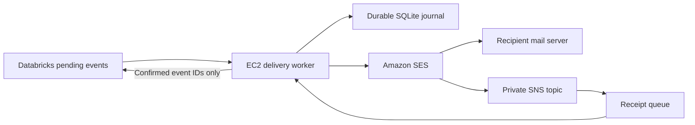

# Drift alert delivery with receipts

This worker sends pending drift events through Amazon SES and updates Databricks
only after SES confirms delivery to the configured recipient's mail server.
`SendEmail` acceptance, query success, and elapsed time never count as delivery.
Server acceptance does not prove that a person read the email or that it avoided
their spam folder. This is the [SES delivery-event definition](https://docs.aws.amazon.com/ses/latest/dg/event-publishing-retrieving-sns-contents.html).



## What changed

- Notebook 51 no longer retires events after one hour or writes notification timestamps.
- A resolved alert produces one recovery event; later normal windows do not create
  another recovery email.
- The saved SQL alert uses `has_pending_event > 0`, including low-PSI recovery events.
  Its Quartz schedule is `0 0/10 * * * ?` (every ten minutes).
- The worker polls every ten minutes by default. It sends at most 50 events in
  one email, to **one configured recipient mailbox**. Use separate environments
  for DEV and production. Do not run multiple workers against the same event tables.
- Each attempt is committed locally before sending. Receipts include the attempt
  tag, batch tag, SES message ID, recipient, account, and configuration set.
- The receipt is committed before its SQS message is deleted. If Databricks is
  unavailable afterward, acknowledgement is retried from the journal on restart.
- `SENT` covers only the frozen event IDs contained in that email. Events created
  later, even in the same monitoring run, remain pending.

## Failure behavior

| Situation | Behavior |
|---|---|
| SES accepts email; receipt not received | Keep `PENDING`; retry after `RETRY_SECONDS` (default one hour) |
| Send response times out | Keep the precommitted attempt; correlate a later receipt using its tag |
| Databricks update fails | Keep the durable receipt; retry idempotent updates next cycle |
| Bounce, complaint, reject, rendering failure | Keep `PENDING`, block automatic retries for that batch, log failure |
| Duplicate delivery receipt | No duplicate acknowledgement or new email |
| Unknown or mismatched receipt | Do not delete it; SQS eventually moves it to the dead-letter queue |
| New normal window after resolution | No new recovery event |

Delivery is **at least once**, not exactly once. A delayed/missing receipt can
cause a duplicate email during retry. This preserves notifications rather than
discarding them. Failed permanent deliveries require operator remediation.

The SQLite journal contains delivery evidence and event-to-message mappings. Keep
it on durable EBS storage outside Git, back it up consistently using SQLite's
backup API, and retain it across deployments. Never replace it with an empty file
to clear a problem. Losing it can cause resends and unknown receipts. Restoring
an old backup can also cause resends; inspect it before restarting.

## Local checks and feature branch

Nothing in these tests sends email or contacts AWS/Databricks. Java 21 and Python
3.12 are used in the dedicated `Alert Delivery CI` workflow.

```bash
git switch -c feature/alert-delivery-receipts
python -m pip install 'pytest>=8,<10' 'pyspark==4.1.1' 'boto3>=1.35,<2' 'cfn-lint>=1,<2'
python -m pytest -q services/alert_delivery/tests
cfn-lint services/alert_delivery/deploy/aws-resources.json
```

Review and commit the changes, then push your feature branch. The new CI workflow
runs for pull requests and feature/codex branch pushes. It has no cloud credentials
or deployment steps. Existing Dash CI/CD is unchanged.

## DEV setup (operator deployment steps)

### 1. Use isolated data and a test recipient

Set `PM_CATALOG=predictivemaintenance_dev`. The worker has **no default catalog**.
The DEV catalog must contain `gold_data.prediction_monitoring_drift_alert_events`
and `gold_data.prediction_monitoring_drift_alert_state` with the notebook's schemas.
Create these using the existing DEV bundle/notebooks, or an isolated test setup.
Do not point DEV at production tables to make a missing-table error disappear.
For a DEV copy of the saved SQL Alert, replace its production catalog in the query
with `predictivemaintenance_dev` and use only the test recipient. Leave the live
production alert unchanged until promotion.

Notebook 51 is at `Predictive_Maintenance/notebooks/51_Data_Drift_Monitoring.ipynb`.
Its catalog and deployment-target parameters, including the DEV/production guard,
are preserved. Run the DEV bundle with its DEV catalog parameter. The local Spark
tests execute the changed expressions and SQL without requiring a Databricks job run. The new service does not run ingestion,
training, inference, or drift-monitoring jobs.

Create a **separate Databricks M2M service principal** for this worker with:

- `USE CATALOG` and `USE SCHEMA` on the selected catalog and `gold_data` schema.
- `SELECT` and `MODIFY` on those two tables, and access to the selected SQL warehouse.

The principal does not need permission to modify other tables. Keep the public
Dash app's existing credentials read-only. Store the worker's secret only in its
protected environment file, never in Git or the SQLite journal.

### 2. Provision receipt infrastructure

Use an existing SES-verified sender/domain in `us-east-1`. While SES is in its
sandbox, verify the test recipient too. The template does not verify identities,
request SES production access, send messages, change EC2, or attach permissions.

For example, after replacing the illustrative addresses/identity:

```bash
aws cloudformation deploy --region us-east-1 \
  --stack-name pm-alert-delivery-dev \
  --template-file services/alert_delivery/deploy/aws-resources.json \
  --capabilities CAPABILITY_IAM \
  --parameter-overrides \
    ConfigurationSetName=pm-alerts-dev \
    VerifiedSesIdentity=example.com \
    SenderEmail=alerts@example.com \
    RecipientEmail=operator@example.com

aws cloudformation describe-stacks --region us-east-1 \
  --stack-name pm-alert-delivery-dev --query 'Stacks[0].Outputs'
```

The template creates an SES configuration set, an SNS topic restricted to that
configuration set/account, a private SQS subscription with raw message delivery,
a 14-day receipt queue and dead-letter queue, and a restricted IAM managed policy.
It does not attach the policy. Attach `WorkerPolicyArn` to the worker's EC2 role
after review. It permits sending only from the configured sender to the configured
recipient and consuming only this queue. No inbound HTTP port is needed.

Configure an operations notification for the dead-letter alarm and monitor worker
errors and old pending batches. The included alarm records state but has no
notification recipient until you assign an `AlarmAction`. SQS receipts expire
after 14 days; restore service before the queue retention period elapses.

### 3. Install the worker separately from Dash

Copy `worker.py`, `requirements.txt`, and the service definition to the EC2 host
from the exact tested feature commit. Keep the existing Dash/on-demand environments
unchanged. The following are deployment instructions, not commands run by the tests:

```bash
sudo useradd --system --home-dir /var/lib/pm-alert-delivery \
  --shell /usr/sbin/nologin pm-alert-delivery
sudo install -d -m 0755 /opt/pm-alert-delivery
sudo install -m 0644 services/alert_delivery/worker.py /opt/pm-alert-delivery/worker.py
sudo install -m 0644 services/alert_delivery/requirements.txt /opt/pm-alert-delivery/requirements.txt
sudo python3 -m venv /opt/pm-alert-delivery/venv
sudo /opt/pm-alert-delivery/venv/bin/python -m pip install -r /opt/pm-alert-delivery/requirements.txt
sudo install -m 0600 services/alert_delivery/deploy/worker.env.example /etc/pm-alert-delivery.env
sudoedit /etc/pm-alert-delivery.env
sudo install -m 0644 services/alert_delivery/deploy/pm-alert-delivery.service /etc/systemd/system/
sudo systemctl daemon-reload
```

Fill every placeholder in `/etc/pm-alert-delivery.env` using the DEV stack outputs,
test recipient, DEV service principal, and SQL warehouse. `DATABRICKS_SERVER_HOSTNAME`
is a hostname without `https://`. `PM_DELIVERY_DB` must remain outside the repository.
AWS credentials come from the EC2 role; do not add permanent AWS keys to the file.

### 4. Verify real delivery in DEV

1. Keep the native SQL Alert paused or without email subscribers. Its native email
   path cannot provide the worker's delivery receipts and would send duplicates.
2. Seed a clearly identified DEV-only pending `RESOLVED` event with PSI below 0.1
   and its feature-state row. Also test a high-PSI `NEW_ALERT` event. Use the normal
   table schemas and unique event IDs; do not alter production events.
3. Start the worker with `sudo systemctl start pm-alert-delivery` and follow
   `sudo journalctl -u pm-alert-delivery -f`.
4. Confirm the test email contains the expected event IDs and transitions.
5. Confirm the journal records an SES `Delivery` receipt and provider message ID,
   then verify only those event IDs became `SENT` and the feature timestamp advanced.
6. Test a temporary Databricks permission/connection failure in this isolated DEV
   setup. After restoring access, acknowledgement must succeed from the saved receipt.
7. Check for empty dead-letter queue and no worker errors. Then enable the service
   at boot with `sudo systemctl enable pm-alert-delivery`.

SES receipt routing, actual email delivery, and Databricks `MODIFY` permissions
must pass this feature-environment test before production promotion. Local mocked
provider tests cannot verify those account-specific settings.

## Production promotion and rollback

After the feature branch CI and DEV delivery test pass, review/merge the code and
deploy that exact commit. This repository's existing Dash deployment does **not**
install this worker or provision AWS resources; those are separate deployment steps.

Create a separate production stack/configuration set/queue/journal and configure
the intended production catalog, sender, recipient, and dedicated credentials.
Deploy Notebook 51's fixes **before** enabling the worker, so the old hourly
retirement code cannot discard events while receipts are pending. Update the saved
SQL Alert configuration too, but keep its native notifications paused/disabled
when the worker is authoritative. If you keep it for UI inspection, its query can
still show pending actionable events.

Existing `SENT` rows written by the old timer are not proof of delivery. Do not
mass-reset them: review old notifications and requeue only identified missed
events. Neither this patch nor the worker changes historical rows automatically.

For rollback, stop/disable the new worker and retain its journal and receipt queues.
Leave Notebook 51's removal of time-based retirement in place. Pending events are
safe to keep while you repair delivery; restoring the old timer reintroduces loss.
Do not enable both native emails and the receipt worker unintentionally.

## Operations

Run `worker.py --status` with the same protected environment to inspect batch IDs,
attempts, provider message IDs, receipts, and acknowledgement state. It does not
connect to AWS/Databricks. The service's file lock prevents concurrent access while
the worker is running; stop the service before this command, then restart it.

After diagnosing and correcting a permanent failure, `worker.py --retry-failed
BATCH_ID` allows another attempt for that batch. This is an explicit operator
action and never marks an event delivered. Do not retry complaints until the
recipient has agreed to receive further messages. Changing recipient/workspace/
catalog/queue requires a separate journal and a reviewed migration of pending work;
the worker refuses to reuse delivery evidence from another environment.

For troubleshooting, inspect the SES configuration-set event destination, SNS
topic policy/subscription, SQS dead-letter queue, worker log, and journal together.
The worker logs identifiers and exception types, not credentials or email bodies.

References: [SES receipt contents](https://docs.aws.amazon.com/ses/latest/dg/event-publishing-retrieving-sns-contents.html),
[SES-to-SNS permissions](https://docs.aws.amazon.com/ses/latest/dg/event-publishing-add-event-destination-sns.html),
[Databricks alert repeat semantics](https://docs.databricks.com/api/alerts/v2/alert).
